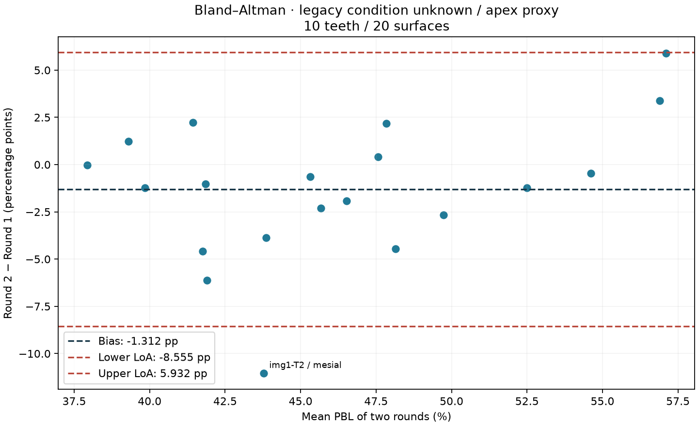
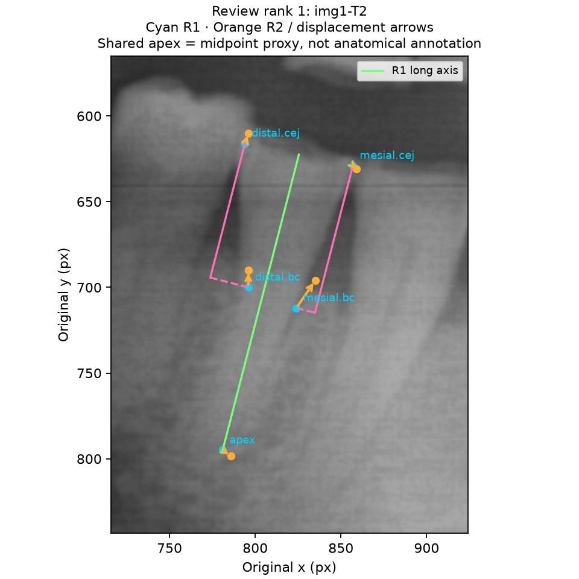
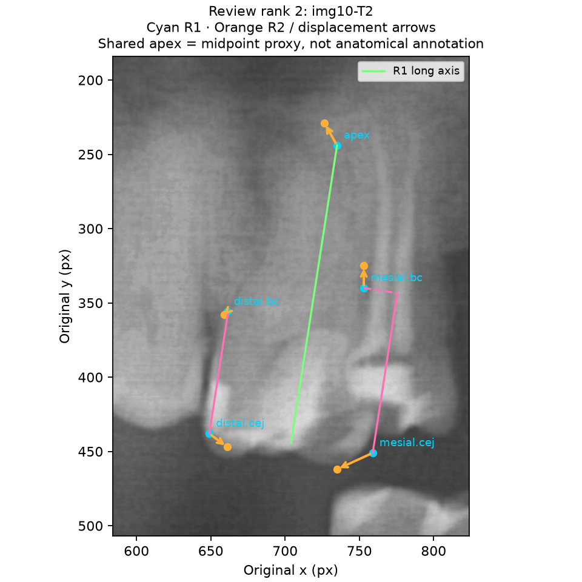
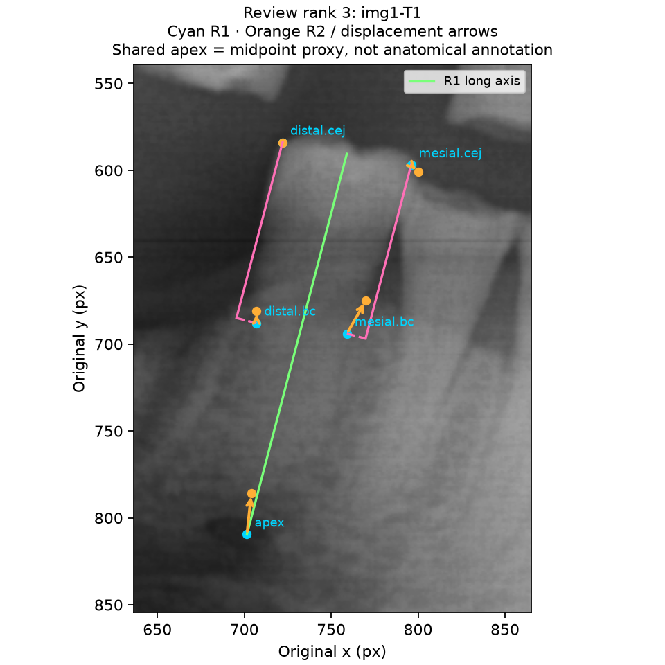
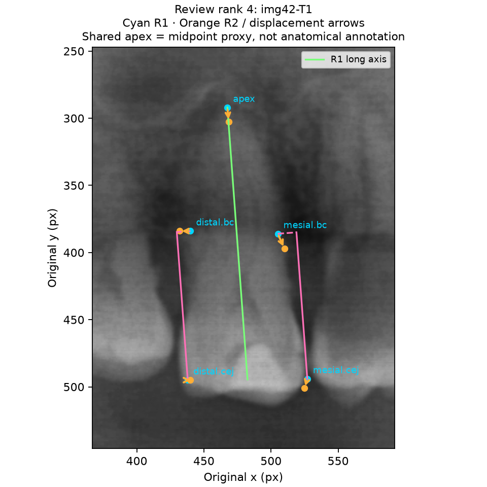
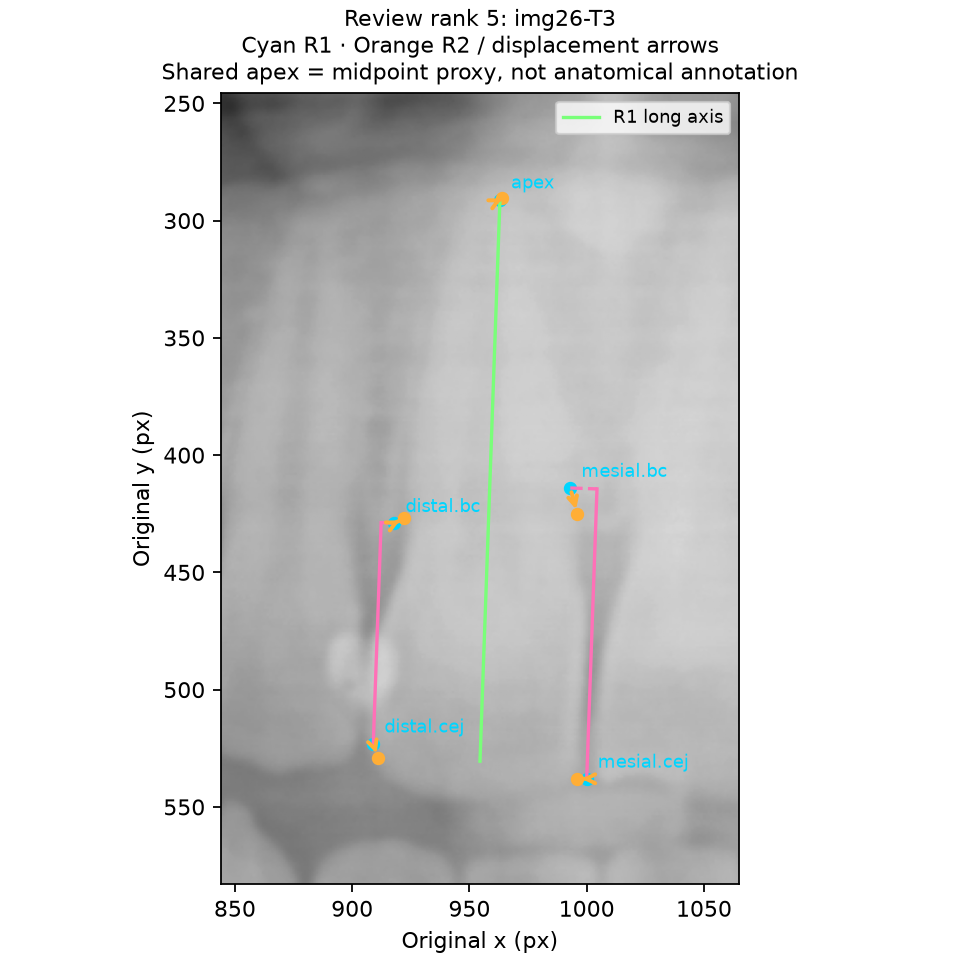
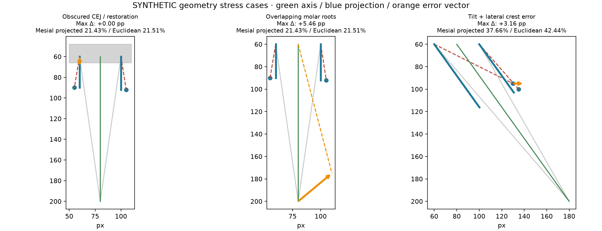
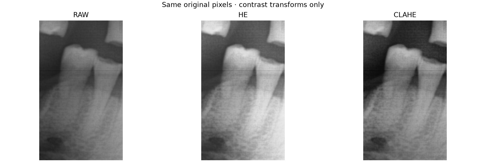
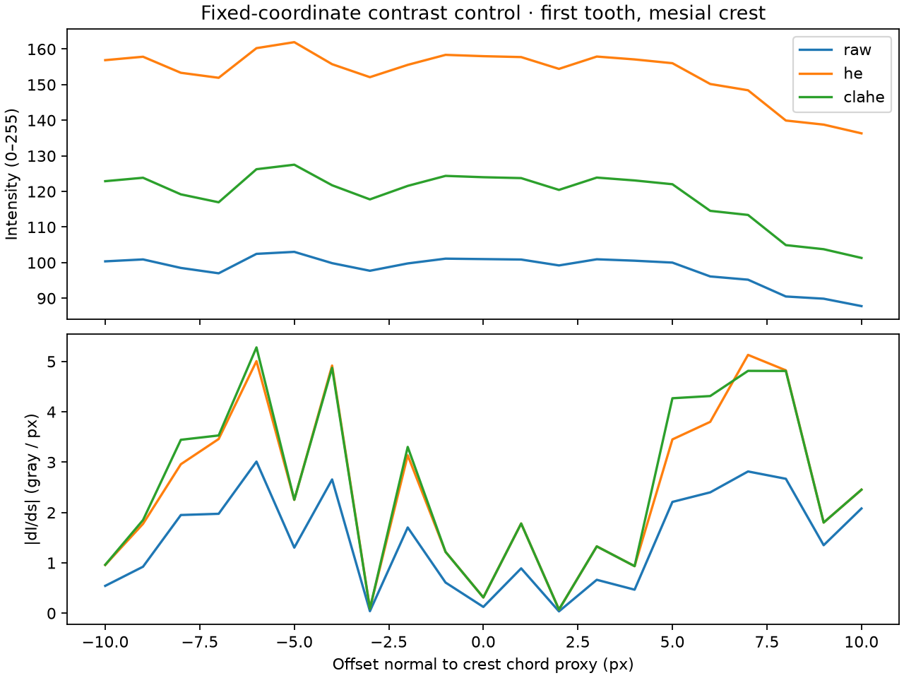

# Week 3 — Statistical verification and failure analysis

## Evidence status

**Exploratory analysis only: 10 paired teeth / 20 surfaces, target 15 / 30.** Source: `week2/measurements.csv`, Lucia's same-day readings. Existing records have unknown enhancement state and two side-specific root tips. The shared apex used here is the arithmetic midpoint of those tips (unrounded); this is an **analytic proxy, not a newly identified anatomical apex**. All PBL percentages below were recomputed with projected geometry; Week 2 percentages were not reused. The Week 3 app collects the required shared anatomical apex directly.

No new manual readings were fabricated. 5 additional teeth, independent repeats, condition-specific annotations, crown points, and clinically confirmed restoration/overlap cases remain to be collected. The synthetic exports are separate software examples and do not satisfy the empirical sample requirement.

Data limits that shape every coefficient below: the Round 1 → Round 2 interval was 19 min median (range 12–362 min), so recall of earlier clicks is likely; the 10 teeth come from only 4 images; and all 40 surface readings lie within 37.9–60.1% PBL. That narrow range lowers ICC for a given measurement error and leaves stage kappa undefined.

## Statistical verification

| Metric | Recomputed result |
| --- | ---: |
| Surface ICC, two-way, absolute agreement, single measure | 0.7970 |
| ICC 95% CI (McGraw & Wong) | 0.559 to 0.914 |
| Koo & Li 2016 band of the CI | moderate to excellent |
| Surface quadratic weighted kappa | undefined (all observations in one category; expected disagreement = 0) |
| Tooth worse-side stage kappa | undefined (all observations in one category; expected disagreement = 0) |
| Mean bias, Round 2 − Round 1 | -1.312 pp |
| Sample SD of differences | 3.696 pp |
| 95% lower LoA | -8.555 pp |
| 95% upper LoA | +5.932 pp |
| Descriptive bias SE (ignores tooth clustering) | 0.826 pp |
| Difference-versus-mean slope | 0.2466 pp / pp |
| Surfaces strictly outside LoA | 1 / 20 |

ICC uses balanced two-way ANOVA: `(MS_subject − MS_error) / (MS_subject + (k−1)MS_error + k(MS_round−MS_error)/n)`, k=2. For one reader's repeated readings Koo & Li (2016) recommend the two-way mixed-effects, absolute-agreement, single-measure model; McGraw & Wong's ICC(A,1) estimate and its confidence interval are identical under the random and mixed models, so this is that coefficient. Interpret the 95% CI, not the point estimate, using Koo & Li's bands (<0.5 poor, 0.5–0.75 moderate, 0.75–0.9 good, >0.9 excellent); the interval treats surfaces as independent, so with two surfaces per tooth it is optimistic. Quadratic kappa uses fixed ordered classes I, II, III/IV and disagreement weights `(i−j)²/4`. Zero expected disagreement produces an undefined coefficient, not a perfect score. LoA = mean difference ± 1.96 × sample SD (ddof=1); these are limits for individual differences, not confidence intervals on the limits. Both surface and worse-side tooth stages use the exact assignment thresholds: <15, 15–33 inclusive, >33.

The observed mean shift is -1.312 pp against a difference SD of 3.696 pp. Directional drift may coexist with placement noise; this small, same-day dataset cannot establish their cause or prove systematic bias absent. Review coordinate arrows and the descriptive slope before attributing error to landmark drift. Mesial and distal surfaces share a tooth/apex and are correlated; the pooled surface coefficients are descriptive, and independence-based confidence claims would be inappropriate. No observer generalization or production/clinical validation is claimed.

## Largest tooth residuals (top 5)

Rank by the maximum of the two absolute bias-centered surface differences. **Only 1 surface is outside the calculated LoA; the table lists 5 review cases, not 5 claimed outliers.** An outlier is a flag for review, not evidence of pathology.

| Rank | Legacy tooth ID | Mesial Δ pp | Distal Δ pp | Any surface outside LoA |
| --- | --- | ---: | ---: | --- |
| 1 | img1-T2 | -11.046 | -3.860 | True |
| 2 | img10-T2 | +5.906 | -1.231 | False |
| 3 | img1-T1 | -6.128 | +2.173 | False |
| 4 | img42-T1 | -1.237 | +3.380 | False |
| 5 | img26-T3 | -4.457 | +2.236 | False |

Cyan: Round 1; orange: Round 2; arrows: original-coordinate displacement; green: R1 axis; pink: projected crest distance and lateral residual. Shared-apex displacements reflect both original root tips. Without expert labels these images cannot establish obscured CEJs, overlapping molar roots, or a specific failure cause.

The separate **synthetic** restoration, overlapping-root, and tilted-tooth examples demonstrate coordinate error vectors. In the tilted example, a lateral component inflates Euclidean distance; projected distance removes that component. Changing a CEJ or apex can rotate the axis, so even a normal displacement may change both surfaces. Collinear landmarks are valid if projected lengths are positive; only degenerate zero/negative projected root lengths are rejected. Lateral distance alone is not grounds for rejecting a valid axial crest position.

## Landmark error decomposition

Round-to-round displacement is resolved along each tooth's R1 axis (+ toward apex) and its normal `(-u_y, u_x)`. RMS displacement² = magnitude of mean drift² + centered residual RMS² (population normalization, denominator n). These are descriptive components in a local coordinate frame, not proof of causal systematic/random errors. The proxy apex averages two clicks and can conceal opposing root-tip errors.

| Landmark | Mean parallel px | Mean normal px | Total RMS px | Mean drift magnitude px | Centered residual RMS px |
| --- | ---: | ---: | ---: | ---: | ---: |
| mesial.cej | -1.909 | -3.155 | 9.742 | 3.687 | 9.017 |
| mesial.bc | -5.709 | -2.245 | 12.398 | 6.135 | 10.773 |
| distal.cej | -1.685 | +3.695 | 8.252 | 4.061 | 7.184 |
| distal.bc | -3.424 | +3.499 | 9.247 | 4.895 | 7.844 |
| apex | -2.299 | +0.680 | 10.803 | 2.397 | 10.533 |

A large mean component suggests directional placement drift to investigate; a large centered component suggests heterogeneous placement error. With only two same-day rounds and no reference landmarks, the components cannot distinguish observer memory, anatomy, projection changes, and random noise.

## Coordinate sensitivity

All 10 R1 geometries × five landmarks × two directions × three magnitudes × two signs = 600 trials. Move only one landmark per trial using the baseline unit axis or its normal, then recompute the axis and both percentages. Units are original pixels, with continuous shifts (not rounded for stress testing). Invalid placements are retained as rejection rows, never converted to zero loss. Summary uses absolute change in **worse-side** PBL; the full CSV also contains both surfaces and stage flips.

| Magnitude px | Direction | Mean absolute Δ pp | Maximum absolute Δ pp | Rejected / trials |
| --- | --- | ---: | ---: | ---: |
| 2 | parallel | 0.382 | 1.113 | 0 / 100 |
| 2 | normal | 0.021 | 0.107 | 0 / 100 |
| 5 | parallel | 0.951 | 2.782 | 0 / 100 |
| 5 | normal | 0.052 | 0.285 | 0 / 100 |
| 10 | parallel | 1.890 | 5.564 | 0 / 100 |
| 10 | normal | 0.105 | 0.627 | 0 / 100 |

## Raw / HE / CLAHE comparison

CLAHE uses OpenCV clip limit 2.0 and tile grid (8,8). Global HE uses `equalizeHist`. Grayscale conversion preserves the image grid; no resizing enters analysis. The fixed-coordinate edge experiment uses R1 points on each of 10 teeth and samples ±10 px at 1-px spacing, bilinearly, normal to the line connecting the two bone crests. **That line is a crest-tangent proxy, not a local expert contour.** Gradient is `abs(gradient(intensity))`, gray levels per pixel; peaks are descriptive and can reflect noise. These are contrast transforms only, not an added blur/noise degradation experiment.

| Condition | Fixed profiles | Mean peak gradient (gray / px) | Independent coordinate RMSD | Within-condition placement variance |
| --- | ---: | ---: | --- | --- |
| raw | 20 | 3.867 | N/A | N/A |
| he | 20 | 6.182 | N/A | N/A |
| clahe | 20 | 7.361 | N/A | N/A |

Transforms do not move the stored coordinates. Copying the same points across conditions would trivially yield RMSD=0 and cannot establish localization stability. Therefore missing independent coordinate RMSD/variance are N/A. The new analysis command accepts independently re-annotated strict-schema records, matches image/tooth/round across all three conditions, calculates `sqrt(mean(dx²+dy²))` against raw and across rounds, and reports average within-landmark x+y sample variance in px². Contrast gains alone do not demonstrate a more accurate bone boundary.

## Deliverables and remaining data

- Typed projected-axis engine, custom geometry errors, optional crown-based ratio warnings, exact stage thresholds and III/IV review flag: implemented.
- JSON Schema, coordinate/metric recomputation, automatic JSON and flattened CSV downloads: implemented.
- Reproducible plots, sensitivity CSV, fixed-coordinate edge table, analysis of future matched contrast annotations: implemented.
- Empirical requirement: **10/15 teeth**, enhancement condition unknown; new shared-apex and contrast measurements still needed.
- Structured exports: `exports/synthetic/` contains 90 explicitly synthetic examples; no empirical condition labels were guessed.
- Branch coverage: see the saved test output and coverage JSON generated with the README command.
- Public repository/PR: local work prepared; publishing status is recorded separately, not inferred by this script.

## Methods references

- [Pingouin ICC definitions and estimator documentation](https://pingouin-stats.org/generated/pingouin.intraclass_corr.html)
- [Scikit-learn quadratic weighted Cohen kappa](https://scikit-learn.org/stable/modules/generated/sklearn.metrics.cohen_kappa_score.html)
- [OpenCV CLAHE API](https://docs.opencv.org/3.4.17/d6/db6/classcv_1_1CLAHE.html)
