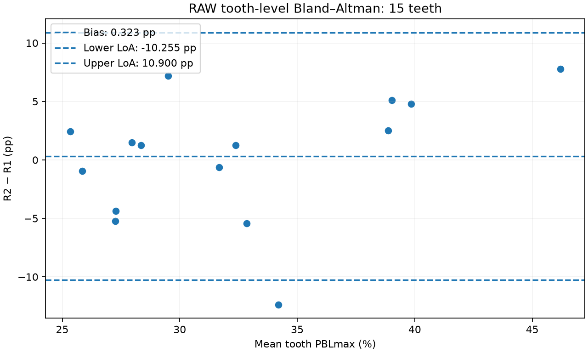
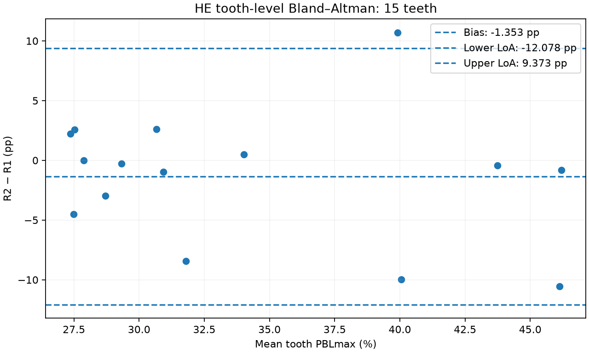
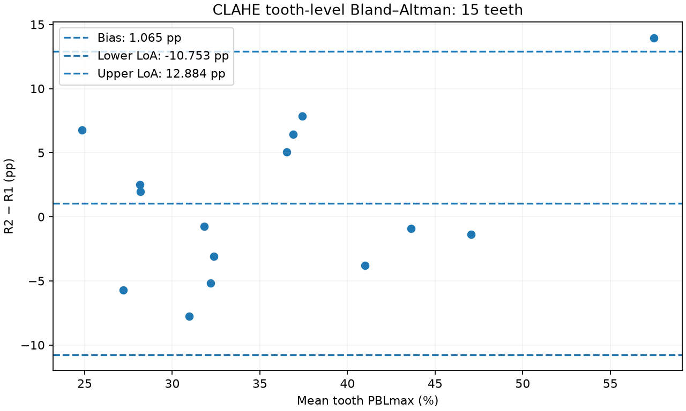
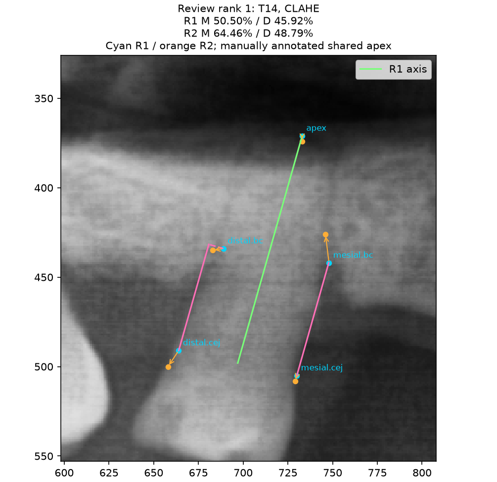
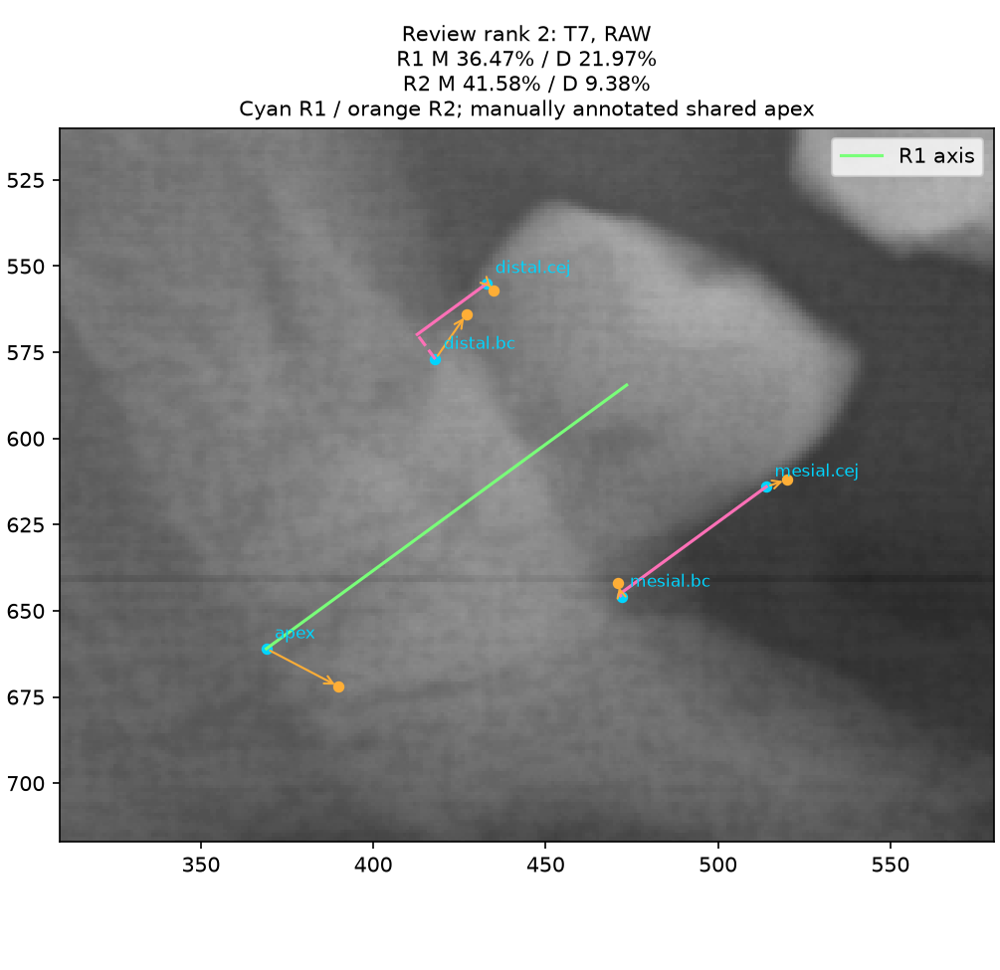
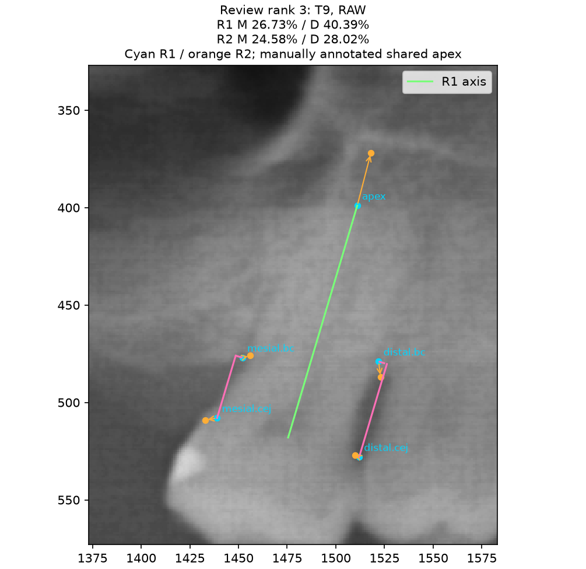
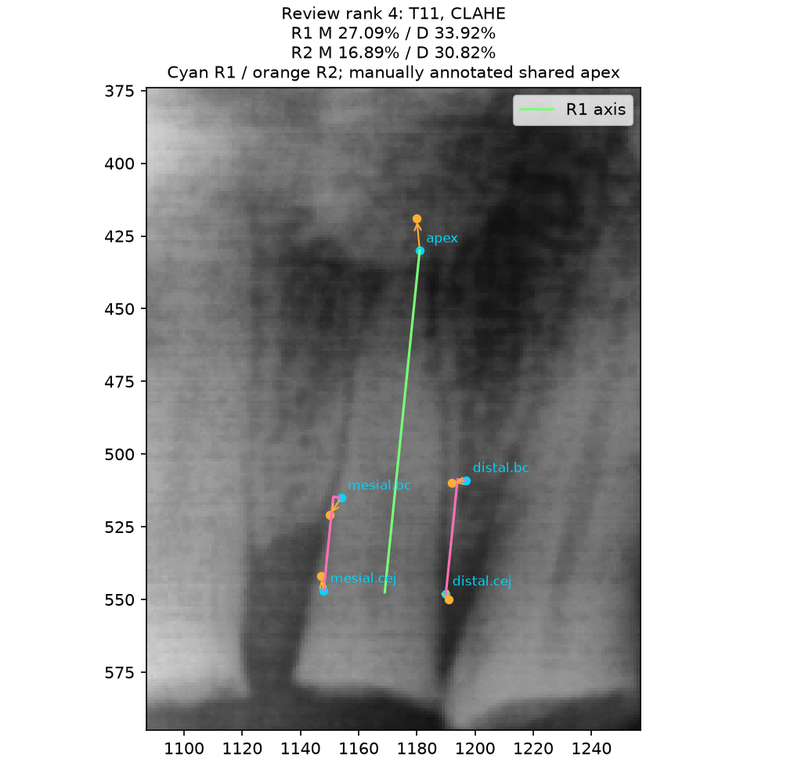
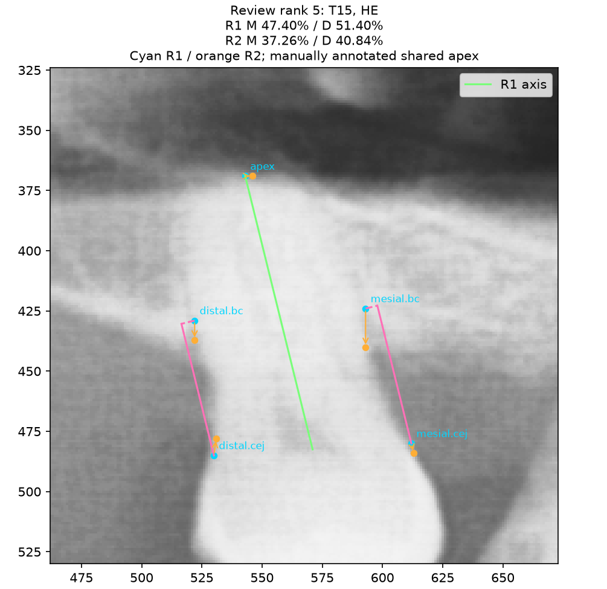
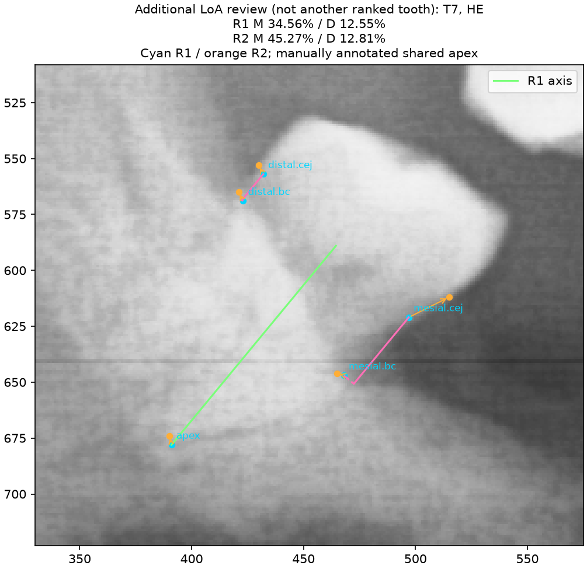

# Week 3 Report: Repeatability and Image Contrast in the PBL Calculator

## Introduction

For this week's project, I continued working on the periodontal bone loss (PBL) calculator from Week 2. The main goal was to examine how much the measurements changed when I marked the same teeth again, and whether image enhancement affected the placement of the landmarks. I also used the project to check the calculation method and how the software handled invalid points. This was intended to help identify areas that still needed improvement before considering broader use of the calculator.

To do this, I marked the same 15 teeth on one panoramic radiograph, `kaggle_dental_xray_1.jpg`, under three image conditions: Raw, global histogram equalization (HE), and CLAHE. I completed two rounds for each condition, which gave 90 saved tooth readings and 180 surface observations. All coordinates were kept in the original 2041 × 1024 image size. The tooth IDs were used to keep track of the selected teeth across the different conditions and rounds; they were not clinical tooth numbers. The data checks confirmed that each group contained the same 15 tooth IDs, with no missing or duplicate readings. I kept the saved points unchanged during the analysis.

## Methods

### Collecting the measurements

For each tooth, I selected the mesial and distal cementoenamel junctions (CEJs), the two bone crests, and one shared anatomical root apex. The calculator used the midpoint between the CEJs and the selected apex to define the long axis of the tooth. The bone-loss distance and root length were then measured along this axis. This helped keep the calculation tied to the direction of the root rather than using the straight-line distance between any two points.

For the contrast comparison, global HE used `equalizeHist`, while CLAHE used a clip limit of 2.0 and an 8 × 8 tile grid. These operations changed the image intensity without changing the pixel grid. I interpreted the assignment’s “tile grid = 88” as an 8 × 8 tile grid. I placed new clicks for each condition, rather than copying coordinates. However, the fixed RAW → HE → CLAHE order meant that the readings could still be affected by practice and recall.

The final software stage was based on the side with the higher PBL percentage. I used the assignment thresholds of less than 15%, 15–33% inclusive, and greater than 33%. These categories were used to compare the calculator outputs. They did not provide a full clinical diagnosis.

The saved evidence placed the two rounds about 13 hours apart on the same date, 2026-10-23 (UTC and local UTC-4). The current study was created at 04:26:07 UTC, and the complete Round 1 backup was saved at 04:49:30 UTC. Round 2 saves ran from 17:47:18 to 18:00:09 UTC. These give a conservative interval range of 12.96–13.57 hours; they do not give an exact interval for each tooth. My earlier description of “about one day” was incorrect. I used these time bounds because individual Round 1 timestamps were not available.

Before the analyzed collection, I completed an earlier RAW session with 15 readings on the same 15 registered locations. That study was archived when I restarted the workflow at my request. The specific reason was not recorded in the structured study log, so I cannot give a more detailed reason from those records. The archived session was complete by 04:16:38 UTC and is preserved separately in [excluded_raw_round1.json](protocol_history/excluded_raw_round1.json). It was not included in any reported agreement or contrast calculation. The final RAW Round 1 minus archived RAW reading PBLmax difference was +3.85 pp (sample SD 2.29 pp). I therefore saw these RAW teeth at least three times, including the excluded session. Keeping the final saved points unchanged during analysis does not mean that there was no earlier measurement attempt.

Both rounds followed RAW → HE → CLAHE, as supported by the backup snapshots and Round 2 timestamps. The Round 2 tooth save order matched the seeded shuffled order for all three conditions; the Round 1 tooth order could not be verified. The short interval, earlier RAW exposure and fixed condition order could allow practice or memory to affect the results. These effects could increase apparent agreement and are mixed with the contrast comparison. Separate clicks should not be treated as proof of independent perception. In a future study, I would plan the interval and rotate the condition order across sessions.

| Round 2 condition | First–last save (UTC) | First-to-last span (s) | Median consecutive-save interval (s) |
| --- | --- | ---: | ---: |
| RAW | 17:47:18–17:49:24 | 126 | 9 |
| HE | 17:54:08–17:56:31 | 143 | 9 |
| CLAHE | 17:58:00–18:00:09 | 129 | 8 |

The first-to-last Round 2 save span was 12.85 minutes. These are save intervals, not directly measured time spent marking each tooth. The [history evidence](protocol_history/history_evidence.json) records the backup bounds and save order.

### Calculating PBL and checking the geometry

The calculation used the following definitions, where `k` refers to either the mesial or distal side:

```text
m = (CEJ_mesial + CEJ_distal) / 2
u = (apex − m) / ||apex − m||
d_k = (BC_k − CEJ_k) · u
L_k = (apex − CEJ_k) · u
PBL_k = 100 × |d_k| / |L_k|
PBL_max = max(PBL_mesial, PBL_distal)
```

Before calculating the percentage, the program checked that `L_k > 0` and `0 ≤ d_k ≤ L_k`. The purpose of checking the signed distances first was to avoid accepting a crest that was above the CEJ or beyond the apex after taking absolute values. Invalid coordinates, an undefined axis, and invalid bone-crest positions produced specific error messages. Points lying on the same line were still accepted when the axis and projected root lengths were valid.

The program also included an optional crown landmark for the root-to-crown ratio check. Following the assignment, it gave a warning when the ratio was below 1.0 or above 2.5. However, the required export format did not include this extra point, so the ratio could not be checked from these 90 five-landmark records. The geometric checks helped identify invalid inputs, but they could not determine whether I had selected the correct anatomical boundary.

## Results

### Agreement between the two rounds

To compare the two rounds, I used the same 15 teeth, or 30 surfaces, within each condition. The table below presents ICC(2,1), quadratic weighted kappa, mean bias, and the 95% limits of agreement (LoA). All differences were calculated as Round 2 minus Round 1 and are reported in percentage points (pp). I included kappa for both the individual surfaces and the final tooth stage, because the final stage used the worse side of each tooth.

| Condition | Surface ICC(2,1) | Surface weighted κ | Tooth weighted κ | Bias (pp) | 95% LoA (pp) |
| --- | ---: | ---: | ---: | ---: | --- |
| RAW | 0.722 | 0.563 | 0.444 | -0.261 | -10.761 to 10.238 |
| HE | 0.786 | 0.816 | 0.865 | -0.627 | -11.510 to 10.256 |
| CLAHE | 0.825 | 0.718 | 0.609 | +0.199 | -10.996 to 11.395 |

The ICC calculation followed the requested two-way, absolute-agreement, single-measure model:

```text
ICC(2,1) = (MS_subject − MS_error) /
           (MS_subject + (k−1)MS_error + k(MS_round−MS_error)/n)
n = 30 paired surfaces; k = 2 rounds
```

For quadratic weighted kappa, the disagreement weights were `(i−j)²/4` across the three ordered stages, with `κ = 1 − observed weighted disagreement / expected weighted disagreement`. An undefined denominator was left undefined rather than treated as perfect agreement. For the Bland–Altman plots, the mean bias was `mean(R2−R1)`, and the limits were `bias ± 1.96 × sample SD`, using `ddof=1`. I used these limits to describe the spread in this sample; the small dataset did not establish that the differences had a normal distribution or constant variance. Because I was the only reader, the ICC results described my repeated readings and could not show agreement between different readers.

From the results in the table, CLAHE had the highest ICC, while HE had the highest weighted kappa for both surfaces and final tooth stages. This suggested that the conditions did not perform in the same way for every comparison. For example, the condition with the highest continuous agreement did not also have the highest agreement on stage categories.

The mean bias was small for all three conditions, but the standard deviation of the differences was about 5.4–5.7 pp. The agreement limits were therefore still around ±11 pp. This showed that a small average change could occur even when some individual readings changed quite a bit. I did not set an acceptable difference before collecting the data, so I could not use the results to declare that the measurements were sufficiently reliable for clinical use. The two surfaces also shared the same tooth and apex, meaning they were related observations rather than 30 independent teeth.


I also included the ICC confidence intervals calculated by the program. These intervals assumed independent subjects and were not adjusted for the two surfaces coming from the same tooth. As a result, they could make the estimates appear more precise than they really were. The table below should therefore be read together with this limitation.

| Condition | Nominal ICC 95% interval | Difference SD (pp) | Difference–mean slope |
| --- | --- | ---: | ---: |
| RAW | 0.491 to 0.857 | 5.357 | 0.376 |
| HE | 0.598 to 0.892 | 5.552 | -0.256 |
| CLAHE | 0.663 to 0.913 | 5.712 | 0.170 |


### Tooth-level and clustered checks

I also compared worse-side PBLmax using one pair per tooth, so that this check did not count the two surfaces as separate teeth. The results below describe the same 15 teeth; they are a supplement to the surface results.

| Condition | PBLmax ICC(2,1) | Tooth bias (pp) | Tooth 95% LoA (pp) | Correlation of mesial/distal round differences |
| --- | ---: | ---: | --- | ---: |
| RAW | 0.689 | +0.323 | -10.255 to 10.900 | 0.444 |
| HE | 0.742 | -1.353 | -12.078 to 9.373 | 0.561 |
| CLAHE | 0.792 | +1.065 | -10.753 to 12.884 | 0.614 |

I resampled whole teeth 10,000 times with replacement (seed 20261023), retaining both surfaces and rounds together. The percentile intervals below describe the pooled-surface ICC and mean surface bias under this resampling scheme. They do not correct the fixed condition order or the small single-image sample. A bootstrap interval need not be wider than the nominal ANOVA interval, so its upper endpoint alone does not prove that the nominal interval was too narrow.

| Condition | Tooth-cluster bootstrap surface ICC 95% interval | Tooth-cluster bootstrap surface bias 95% interval (pp) |
| --- | --- | --- |
| RAW | 0.489 to 0.819 | -2.336 to +1.767 |
| HE | 0.595 to 0.882 | -3.156 to +1.695 |
| CLAHE | 0.640 to 0.878 | -2.194 to +2.669 |







### Stage counts and confusion matrices

The rows below show Round 1 stages and the columns show Round 2 stages for whole teeth. There were no Stage I teeth in either round. Although the weighting uses three possible classes, the observed tooth comparisons only distinguished II and III/IV.

| Condition | R1 stage | R2 I | R2 II | R2 III/IV |
| --- | --- | ---: | ---: | ---: |
| RAW | I | 0 | 0 | 0 |
| RAW | II | 0 | 7 | 2 |
| RAW | III/IV | 0 | 2 | 4 |
| HE | I | 0 | 0 | 0 |
| HE | II | 0 | 8 | 0 |
| HE | III/IV | 0 | 1 | 6 |
| CLAHE | I | 0 | 0 | 0 |
| CLAHE | II | 0 | 5 | 0 |
| CLAHE | III/IV | 0 | 3 | 7 |

Tooth-stage disagreements were RAW 4/15, HE 1/15, CLAHE 3/15. The apparent difference in agreement therefore involved only a few teeth and could change in another sample. Across all 180 surface observations, 11 were less than 1 pp from 15% or 33%, covering 8 distinct tooth surfaces. Small placement changes near a boundary can change a stage. The engine raised its assignment “furcation / vertical defect review” flag for 42/90 readings above 33%; these were review flags rather than confirmed defects.

### Comparing landmark placement across image conditions

| Condition | Coordinate RMSD vs Raw (px) | R1–R2 coordinate RMSD (px) | Within-landmark coordinate variance (px²) |
| --- | ---: | ---: | ---: |
| RAW | Reference | 8.154 | 33.240 |
| HE | 7.462 | 7.019 | 24.633 |
| CLAHE | 7.972 | 7.722 | 29.813 |

The comparison included 30 complete tooth-and-round groups, with Raw, HE, and CLAHE present in each group. I calculated coordinate RMSD as `sqrt(mean(dx²+dy²))` across the five landmarks. The within-landmark variance was the average of the summed x and y sample variances over the two rounds.

HE had the lowest observed Round 1–Round 2 coordinate RMSD and within-landmark variance, but the fixed reading order prevented attributing that difference to HE alone. The two measures contain the same information here: variance = RMSD²/2. This meant that my points moved less between the two HE readings on average. However, this did not show that the points were closer to the correct anatomical locations. There were no expert reference points to make that comparison.

### Changes in individual landmarks

To understand where the differences came from, I separated each landmark's movement into directions parallel and normal to the Round 1 tooth axis. A positive parallel movement pointed toward the apex, and the normal direction was `(−u_y,u_x)`. The calculation separated the average movement from the remaining variation using `total RMS² = mean drift magnitude² + centered residual RMS²`, with population normalization. The purpose of this step was to see whether there was a common direction of movement or whether the changes varied more across teeth. It did not, by itself, prove that the remaining variation was random noise.

| Condition | Landmark | Mean parallel (px) | Mean normal (px) | Total RMS (px) | Drift magnitude (px) | Centered residual RMS (px) |
| --- | --- | ---: | ---: | ---: | ---: | ---: |
| RAW | mesial.cej | -2.113 | -0.192 | 6.234 | 2.121 | 5.862 |
| RAW | mesial.bc | 1.365 | -0.037 | 5.235 | 1.365 | 5.053 |
| RAW | distal.cej | -0.481 | 0.042 | 6.303 | 0.483 | 6.285 |
| RAW | distal.bc | -2.718 | 1.383 | 7.759 | 3.049 | 7.135 |
| RAW | apex | 3.313 | -1.250 | 12.892 | 3.541 | 12.396 |
| HE | mesial.cej | -0.531 | 0.714 | 8.062 | 0.890 | 8.013 |
| HE | mesial.bc | -1.335 | -0.659 | 7.421 | 1.489 | 7.270 |
| HE | distal.cej | -1.109 | 0.883 | 6.066 | 1.417 | 5.898 |
| HE | distal.bc | -0.918 | 0.377 | 5.680 | 0.992 | 5.593 |
| HE | apex | 0.708 | 1.056 | 7.563 | 1.271 | 7.456 |
| CLAHE | mesial.cej | -1.376 | 0.423 | 6.668 | 1.440 | 6.511 |
| CLAHE | mesial.bc | 0.214 | -1.942 | 8.017 | 1.954 | 7.775 |
| CLAHE | distal.cej | -0.405 | -0.816 | 5.112 | 0.911 | 5.030 |
| CLAHE | distal.bc | 2.294 | 0.709 | 6.971 | 2.401 | 6.545 |
| CLAHE | apex | 5.514 | -0.943 | 10.708 | 5.594 | 9.131 |

Based on this table, the apex had the largest displacement RMS for RAW (12.892 px) and CLAHE (10.708 px), while the mesial CEJ had the largest RMS for HE (8.062 px). This helped identify which landmarks needed closer review in each condition. It also showed why looking only at the average PBL difference would leave out some of the changes in point placement.

### Testing sensitivity to small placement changes

For the sensitivity test, I used the 45 Round 1 geometries as the starting points. The analysis moved one landmark at a time by ±2, ±5, or ±10 pixels, either parallel or normal to the original axis. The program recalculated the long axis and both PBL percentages after each change. This gave 2,700 simulated trials, which were kept separate from the 90 saved readings.

The table below shows the absolute change in the worse-side PBL percentage. Invalid placements would be recorded as rejected trials instead of being counted as zero change.

| Shift (px) | Direction | Mean absolute Δ (pp) | Maximum absolute Δ (pp) | Rejected / trials |
| --- | --- | ---: | ---: | --- |
| 2 | parallel | 0.571 | 1.826 | 0 / 450 |
| 2 | normal | 0.036 | 0.268 | 0 / 450 |
| 5 | parallel | 1.425 | 4.566 | 0 / 450 |
| 5 | normal | 0.091 | 0.716 | 0 / 450 |
| 10 | parallel | 2.834 | 9.132 | 0 / 450 |
| 10 | normal | 0.187 | 1.580 | 0 / 450 |

### Reviewing the five teeth with the largest differences

I then selected five teeth for a closer comparison of their saved landmarks. For each tooth, I took the largest absolute surface difference after subtracting the mean bias for that condition. I ranked the teeth by this value and included the condition responsible for the largest difference in the table below.

Only four surface differences were outside their condition-specific LoA: RAW T7 distal, RAW T9 distal, HE T7 mesial, and CLAHE T14 mesial. Therefore, the five ranked teeth should not all be described as outliers. They were selected to help review the larger differences, and the same tooth could have a flagged surface in more than one condition.

| Rank | Tooth | Condition | Mesial Δ (pp) | Distal Δ (pp) |
| --- | --- | --- | ---: | ---: |
| 1 | T14 | CLAHE | +13.962 | +2.871 |
| 2 | T7 | RAW | +5.111 | -12.592 |
| 3 | T9 | RAW | -2.153 | -12.373 |
| 4 | T11 | CLAHE | -10.202 | -3.096 |
| 5 | T15 | HE | -10.145 | -10.562 |

The figures below show the points from both rounds on the same tooth. Cyan represents Round 1, orange represents Round 2, and the arrows show how the points moved. The green line is the Round 1 long axis, while the pink lines show the projected distances and lateral components. These figures help show where the readings changed, but they do not confirm the reason for the change. In particular, an expert has not confirmed whether these cases involved obscured CEJs, overlapping roots, or another anatomical difficulty.



**T14, CLAHE: signed placement sensitivity.** Each row summarizes five one-landmark trials for that signed shift. “Maximum” means the largest absolute change across the five landmarks, not a single simultaneous shift of all five points. The [case-level CSV](case_sensitivity.csv) retains every landmark result.

| Shift (px) | Direction | Max absolute mesial Δ (pp) | Max absolute distal Δ (pp) | Max absolute PBLmax Δ (pp) | Rejected / 5 |
| --- | --- | ---: | ---: | ---: | --- |
| -10 | parallel | 7.708 | 7.448 | 4.581 | 0 / 5 |
| -10 | normal | 1.263 | 0.194 | 1.263 | 0 / 5 |
| -5 | parallel | 3.854 | 3.724 | 3.854 | 0 / 5 |
| -5 | normal | 0.568 | 0.132 | 0.568 | 0 / 5 |
| +5 | parallel | 3.854 | 3.724 | 3.854 | 0 / 5 |
| +5 | normal | 0.430 | 0.258 | 0.430 | 0 / 5 |
| +10 | parallel | 7.708 | 7.448 | 7.708 | 0 / 5 |
| +10 | normal | 0.715 | 0.635 | 0.715 | 0 / 5 |



**T7, RAW: signed placement sensitivity.** Each row summarizes five one-landmark trials for that signed shift. “Maximum” means the largest absolute change across the five landmarks, not a single simultaneous shift of all five points. The [case-level CSV](case_sensitivity.csv) retains every landmark result.

| Shift (px) | Direction | Max absolute mesial Δ (pp) | Max absolute distal Δ (pp) | Max absolute PBLmax Δ (pp) | Rejected / 5 |
| --- | --- | ---: | ---: | ---: | --- |
| -10 | parallel | 6.908 | 8.752 | 6.908 | 0 / 5 |
| -10 | normal | 0.804 | 0.322 | 0.804 | 0 / 5 |
| -5 | parallel | 3.454 | 4.376 | 3.454 | 0 / 5 |
| -5 | normal | 0.448 | 0.094 | 0.448 | 0 / 5 |
| +5 | parallel | 3.454 | 4.376 | 3.454 | 0 / 5 |
| +5 | normal | 0.532 | 0.039 | 0.532 | 0 / 5 |
| +10 | parallel | 6.908 | 8.752 | 6.908 | 0 / 5 |
| +10 | normal | 1.142 | 0.206 | 1.142 | 0 / 5 |



**T9, RAW: signed placement sensitivity.** Each row summarizes five one-landmark trials for that signed shift. “Maximum” means the largest absolute change across the five landmarks, not a single simultaneous shift of all five points. The [case-level CSV](case_sensitivity.csv) retains every landmark result.

| Shift (px) | Direction | Max absolute mesial Δ (pp) | Max absolute distal Δ (pp) | Max absolute PBLmax Δ (pp) | Rejected / 5 |
| --- | --- | ---: | ---: | ---: | --- |
| -10 | parallel | 7.998 | 8.108 | 8.108 | 0 / 5 |
| -10 | normal | 0.252 | 0.943 | 0.943 | 0 / 5 |
| -5 | parallel | 3.999 | 4.054 | 4.054 | 0 / 5 |
| -5 | normal | 0.169 | 0.415 | 0.415 | 0 / 5 |
| +5 | parallel | 3.999 | 4.054 | 4.054 | 0 / 5 |
| +5 | normal | 0.249 | 0.292 | 0.292 | 0 / 5 |
| +10 | parallel | 7.998 | 8.108 | 8.108 | 0 / 5 |
| +10 | normal | 0.574 | 0.453 | 0.453 | 0 / 5 |



**T11, CLAHE: signed placement sensitivity.** Each row summarizes five one-landmark trials for that signed shift. “Maximum” means the largest absolute change across the five landmarks, not a single simultaneous shift of all five points. The [case-level CSV](case_sensitivity.csv) retains every landmark result.

| Shift (px) | Direction | Max absolute mesial Δ (pp) | Max absolute distal Δ (pp) | Max absolute PBLmax Δ (pp) | Rejected / 5 |
| --- | --- | ---: | ---: | ---: | --- |
| -10 | parallel | 8.351 | 8.586 | 6.827 | 0 / 5 |
| -10 | normal | 0.152 | 0.960 | 0.960 | 0 / 5 |
| -5 | parallel | 4.175 | 4.293 | 4.293 | 0 / 5 |
| -5 | normal | 0.057 | 0.425 | 0.425 | 0 / 5 |
| +5 | parallel | 4.175 | 4.293 | 4.293 | 0 / 5 |
| +5 | normal | 0.151 | 0.307 | 0.307 | 0 / 5 |
| +10 | parallel | 8.351 | 8.586 | 8.586 | 0 / 5 |
| +10 | normal | 0.392 | 0.492 | 0.492 | 0 / 5 |



**T15, HE: signed placement sensitivity.** Each row summarizes five one-landmark trials for that signed shift. “Maximum” means the largest absolute change across the five landmarks, not a single simultaneous shift of all five points. The [case-level CSV](case_sensitivity.csv) retains every landmark result.

| Shift (px) | Direction | Max absolute mesial Δ (pp) | Max absolute distal Δ (pp) | Max absolute PBLmax Δ (pp) | Rejected / 5 |
| --- | --- | ---: | ---: | ---: | --- |
| -10 | parallel | 8.045 | 9.132 | 5.165 | 0 / 5 |
| -10 | normal | 1.254 | 0.799 | 0.799 | 0 / 5 |
| -5 | parallel | 4.023 | 4.566 | 3.994 | 0 / 5 |
| -5 | normal | 0.559 | 0.497 | 0.497 | 0 / 5 |
| +5 | parallel | 4.023 | 4.566 | 4.566 | 0 / 5 |
| +5 | normal | 0.409 | 0.679 | 0.679 | 0 / 5 |
| +10 | parallel | 8.045 | 9.132 | 9.132 | 0 / 5 |
| +10 | normal | 0.659 | 1.523 | 1.523 | 0 / 5 |

The ranked T7 image shows RAW, which produced its largest residual. HE T7 mesial was also outside its own LoA; I included that distinct reading below so the ranking did not hide a flagged condition.



### Comparing the image gradients near the bone crest

For the image-gradient comparison, I kept the RAW Round 1 crest locations fixed across all three image conditions. This allowed the analysis to compare the intensity changes without also changing the sampling locations. Each profile covered ±10 original pixels at one-pixel intervals, perpendicular to the line joining the two bone crests.

The line between the crests was used as an approximate tangent because an expert local bone contour was not available. This was a limitation of the method. A higher peak gradient could reflect a stronger edge, but it could also include amplified noise.

| Condition | Profiles | Mean peak gradient (gray levels/px) |
| --- | ---: | ---: |
| RAW | 30 | 4.225 |
| HE | 30 | 6.962 |
| CLAHE | 30 | 7.674 |


I added a restricted ±3 px check near the saved crest because the strongest full-window gradient could occur away from it. The table below also shows the location of the full-window peak. This extra check still uses unnormalized grayscale intensity, so the HE/CLAHE gain can increase the gradient without improving the correctness of the boundary. I did not use these gradients as evidence of superior landmark accuracy.

| Condition | Mean peak within ±3 px (gray/px) | Median absolute full-peak offset (px) | Full peak at ≥8 px / 30 | Full peak at ±10 px / 30 |
| --- | ---: | ---: | ---: | ---: |
| RAW | 3.526 | 4.5 | 6 | 3 |
| HE | 5.796 | 5.0 | 6 | 4 |
| CLAHE | 6.489 | 4.0 | 6 | 3 |


## Discussion

The tooth-cluster bootstrap intervals for overall surface bias included zero in each condition. I therefore did not find clear evidence of an overall directional PBL shift in this sample. The centered landmark residuals were larger than their mean drift magnitudes, so the variation was mainly heterogeneous across teeth. However, I could not conclude that the errors were purely random or that systematic error was absent. For example, the CLAHE apex had an average parallel shift of about 5.5 px toward the root direction, which still needed review. The short interval, earlier RAW session and fixed condition order could also affect agreement without appearing as a mean PBL shift.

From the different comparisons, I found that the small average PBL changes did not mean that every landmark stayed in the same place. Some changes were larger for the apex, while others were larger for the CEJ or bone crest. The displacement analysis helped separate the average direction of movement from the remaining variation, but two rounds without expert reference points were not enough to determine the cause of these differences. I therefore could not conclude that all of the variation was random or that there was no systematic placement bias.

The image comparisons also showed why more than one measure was useful. CLAHE had the highest observed ICC, while HE had the highest stage agreement and the lowest coordinate variation between rounds. These were descriptive rankings under a fixed reading order. The intensity-gradient results were a separate contrast control and did not establish better anatomical edge localization. Based on these results, I could compare how the conditions behaved in this sample, but I could not identify one condition as the most accurate method for locating the anatomical boundaries.

One limitation of this project was the size and source of the dataset. I measured only 15 selected teeth from one image, and I was the only reader. The two surfaces of each tooth shared an apex, so they were not independent observations. There were also no expert reference points, and some timing information from the first round was unavailable. These factors limited how broadly I could apply the findings.

The primary statistical analysis used only the new 90 readings. The earlier Week 2 measurements and the synthetic examples were kept separate. I also kept the original points unchanged when a larger difference appeared, because changing one round to match the other would no longer show the repeatability of the original readings.

Another limitation was that the clinical categories requested in the assignment had not been confirmed by an expert. The figures could be used to review the saved points, but I could not label them as verified examples of restoration-obscured CEJs, overlapping molar roots, or tilted teeth. I included separate synthetic diagrams to explain these possible mechanisms. They were examples of how the geometry could change, rather than evidence that the same problem occurred in a particular measured tooth.

For future work, I would first ask someone with experience in dental radiographs to review the ambiguous landmarks and identify suitable clinical examples. After that, a larger study with more images, more readers, and a planned interval between rounds and counterbalanced condition order would help evaluate whether the patterns found here also appeared in other measurements. The dataset and backup details for this project are recorded in [COLLECTION_CHECK.md](COLLECTION_CHECK.md).


### Existing radiographic examples

I also reviewed the images and readings already saved in the project. The [radiographic case appendix](radiographic_cases/RADIOGRAPHIC_CASES.md) shows a restoration affecting CEJ identification (Week 2 img10-T3), an upper molar with partly superimposed/indistinct root outlines (current T9), and an angulated tooth (current T7). Each figure uses actual saved Round 1 and Round 2 coordinates. These are visual screening labels rather than expert reference diagnoses. The legacy restoration example retains its original six-point format and remains outside every main statistic; I did not invent a shared anatomical apex. No new markings were required to make these figures.

### Examples of possible geometric errors

The diagram below uses made-up coordinates to show three situations: a shifted CEJ under an obscuring restoration, a different apex selection when roots overlap, and a tilted tooth with lateral crest displacement. The purpose of these examples was to make the effect of point placement easier to see. They were not additional patient measurements or confirmed explanations for the five review cases above.


## Software Testing

The saved automated checks dated 2026-10-23 gave **142 passing Week 3 Python tests**, **219 passing project Python tests**, and **14 passing frontend logic tests**. The PBL engine covered **28/28 branches (100%)** and 105/105 statements. This met the branch coverage target in the assignment. However, passing software tests did not confirm that the anatomical points were correct or that the calculator was ready for clinical use.

The tests covered projected geometry, boundary values, statistical calculations, JSON/CSV round trips, report generation, local record storage, and the frontend coordinate logic. I included the saved [Week 3 test output](week3_test_results.txt), [project test output](project_test_results.txt), [frontend test output](frontend_test_results.txt), and [coverage JSON](full_coverage.json) so the results could be checked alongside the report.

## Data Files and Reproduction

Input JSON SHA-256: `4e9f6cac5410a14ded62961f383377861d0b8f03abaaa72859a30c45a2a3daa8`.

I saved the same 90 readings in [JSON](exports/measurements.json) and [CSV](exports/measurements.csv) formats. The [collection manifest](exports/collection_manifest.json) contains the registered tooth locations, image checksum, and available save times. The source image is the attributed sample in `week2/sample_xrays`. These files keep the measurements used in this report together so that another person can check the calculations.

The report can be regenerated from the repository root using the following commands:

```bash
source .venv/bin/activate
python -m pip install -r week3/requirements.txt
MPLCONFIGDIR=/tmp/pbl-week3-matplotlib python -m week3.reports.collected_study.build_report
```

The report script checks the 15-tooth × 3-condition × 2-round dataset, recalculates the stored results, and checks that the JSON and CSV files agree. It then regenerates the statistics, five review figures, sensitivity trials, displacement tables, and crest profiles. This script is frozen to the audited input JSON checksum, so changing the data stops generation rather than keeping old editorial conclusions. The verification manifest also checks hashes of the saved logs and relevant source files; regenerating the report does not rerun the tests. The evidence date above is the recorded test date, not the generation date. If the code changes, the test commands in the Week 3 README should be run first so that the test records used in the report are also updated.

## Summary of the Week 3 Work

| Deliverable | Current local status |
| --- | --- |
| ICC, weighted kappa, Bland–Altman and 95% LoA | Included for all three conditions |
| Five ranked review teeth and 2/5/10 px sensitivity | Included, with per-case signed ±5/±10 px tables and an additional HE T7 overlay; four surface differences exceed LoA |
| Restoration/overlap/tilt mechanisms | Existing-image screening examples and observed vectors in the appendix, plus synthetic mechanisms; restoration example uses legacy six-point data outside the main statistics |
| Independent Raw/HE/CLAHE localization comparison | Complete: same 15 teeth, both rounds |
| Crest edge profiles | Included, with chord-tangent proxy limitation |
| Typed engine, guardrails and branch target | Verified by current tests and coverage |
| Validated empirical JSON and CSV | Included in exports/ |
| GitHub submission | [My repository and pull request links](SUBMISSION.md) |

## Conclusion

For this week's work, I completed the planned two-round measurements for 15 teeth under Raw, HE, and CLAHE conditions. I used these readings to examine continuous PBL agreement, stage agreement, changes in the individual landmarks, and sensitivity to small placement errors. CLAHE had the highest observed ICC, while HE had the highest observed stage agreement and the lowest coordinate variation. The approximately 13-hour interval, prior RAW exposure and fixed RAW → HE → CLAHE order meant that these differences could not be attributed to contrast enhancement alone.

The main finding was that small average differences could still occur alongside larger changes in individual readings. This helped show which parts of the measurement process needed further attention, especially the selection of ambiguous landmarks. The results were useful for evaluating this version of the calculator, but they were not enough to show that one enhancement method was more accurate or that the system had been clinically validated.

## References

- Absolute-agreement and single-measure ICC terminology: [Pingouin ICC documentation](https://pingouin-stats.org/generated/pingouin.intraclass_corr.html). The project implements its own ANOVA calculation; it does not call Pingouin.
- Quadratic weighted agreement: [scikit-learn Cohen kappa documentation](https://scikit-learn.org/stable/modules/generated/sklearn.metrics.cohen_kappa_score.html). The project implements its own fixed-class calculation.
- Contrast transforms: [OpenCV histogram equalization and CLAHE](https://docs.opencv.org/4.13.0/d5/daf/tutorial_py_histogram_equalization.html).
- Original source/license attribution: [sample image README](../../../week2/sample_xrays/README.md).
- Exact assignment: [Week 3 requirements](ASSIGNMENT_REQUIREMENTS.txt).
