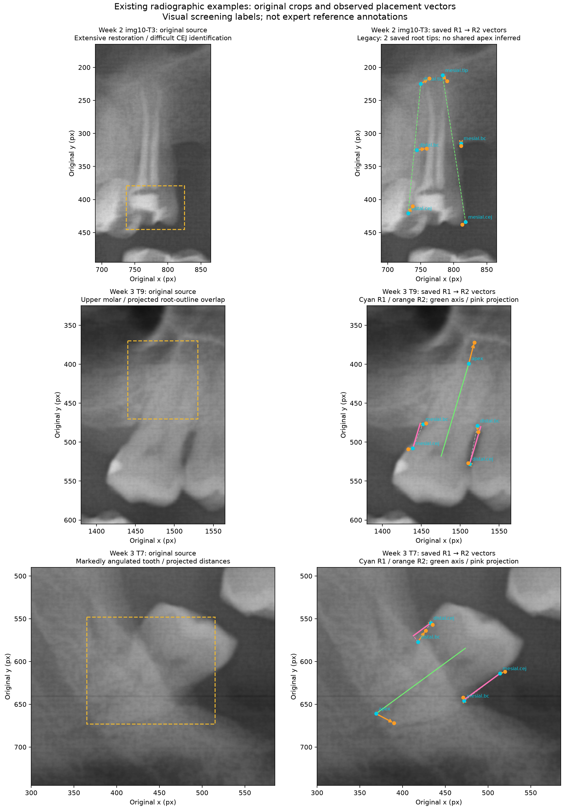

# Existing Radiographic Case Examples

I reviewed the images and saved coordinates already available in the project before asking for any additional marking. I selected the following examples to illustrate the three difficulties in the assignment. These are visual screening interpretations, not independently confirmed clinical labels or proof that a particular feature caused a placement difference.

| Requested difficulty | Existing source | What is visible | Re-marking needed for this figure? |
| --- | --- | --- | --- |
| Restoration affecting CEJ identification | Week 2 img10-T3, sample image 10 | Extensive radiopaque restoration in the crown/cervical region; the natural CEJ is difficult to distinguish from the restoration outline. I do not identify the material or call it a confirmed crown margin. | No: two saved six-point readings are available. |
| Multiple/overlapping molar root outlines | Week 3 T9, sample image 1, RAW | Multiple upper-molar root shadows with indistinct/partly superimposed boundaries. Root count and 3D anatomy cannot be confirmed from this view. | No: both five-point readings are available. |
| Angulated tooth | Week 3 T7, sample image 1, RAW | The tooth and saved long axis are visibly oblique to the image vertical. | No: both five-point readings are available. |

Cyan points are the original Round 1 clicks and orange points are Round 2. Every orange vector is exactly R2 minus R1 in original pixels. The yellow source boxes identify broad review regions; they are not newly selected anatomical points. The arrows show observed placement differences, not error relative to a known true point.

For the two Week 3 cases, green is the saved shared-apex long axis, pink is the axial crest projection, and gray dashed segments show the direct CEJ-to-crest distance. For the legacy restoration example, dashed green lines connect each saved CEJ to its original side-specific root tip. Week 2 did not record one shared anatomical apex. I have not invented one or treated those two tips as a new shared-apex reading.

## Current-case projection comparison

For the two current RAW Round 1 readings, the table compares the projected PBL ratio with a direct Euclidean-distance ratio using the same saved points. Differences demonstrate the effect of geometry, not which reading is anatomically correct.

| Tooth | Side | Projected PBL (%) | Euclidean ratio (%) |
| --- | --- | ---: | ---: |
| Week 3 T9 | mesial | 26.731 | 25.733 |
| Week 3 T9 | distal | 40.390 | 38.766 |
| Week 3 T7 | mesial | 36.468 | 34.641 |
| Week 3 T7 | distal | 21.967 | 21.504 |

## Source and analysis boundaries

The main agreement statistics still use only the 90 current readings. The two Week 2 restoration readings are a contextual failure-case illustration, have an unknown enhancement condition, and are not added to ICC, kappa, Bland–Altman, RMSD, sensitivity-cohort counts or the current study database. This appendix therefore does not require redoing the existing 15-tooth collection. If an additional strict five-point empirical restoration study were requested, it would be a separately planned collection, not a retroactive replacement of these points.

The [source records](source_records.json) preserve which saved observations were plotted. The [vector CSV](observed_vectors.csv) contains every displayed displacement and the [projection CSV](projection_comparison.csv) contains the current-case ratios. The case labels describe the visible radiographic features; they do not claim expert certification.

The distinction between a visible restoration and an identifiable natural CEJ matters: restorations may hide the CEJ, and a restoration outline should not silently be treated as the anatomical junction. See [the radiological assessment around restorations study](https://pmc.ncbi.nlm.nih.gov/articles/PMC9831839/). Panoramic superimposition also limits root interpretation; see [the panoramic-versus-CBCT root evaluation study](https://pmc.ncbi.nlm.nih.gov/articles/PMC10672905/). These papers explain the screening criteria; they do not certify the category or points in these sample images.

Sample image attribution is in [the original image README](../../../../week2/sample_xrays/README.md).
