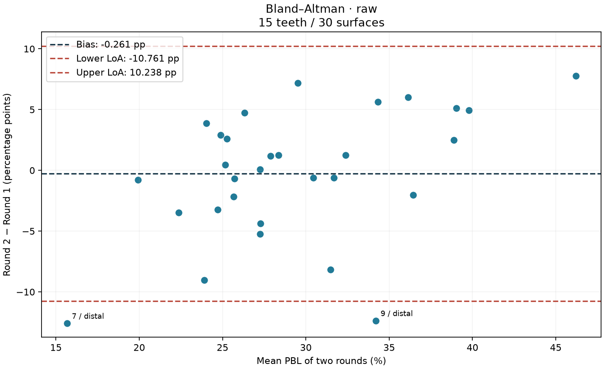
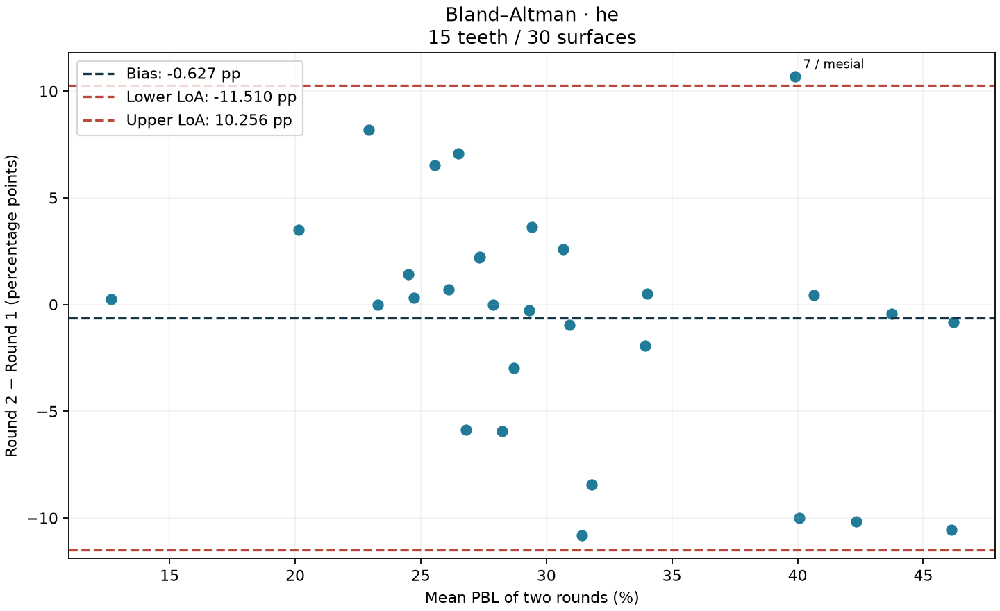
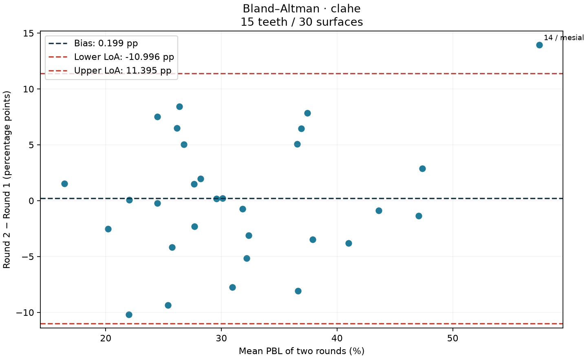
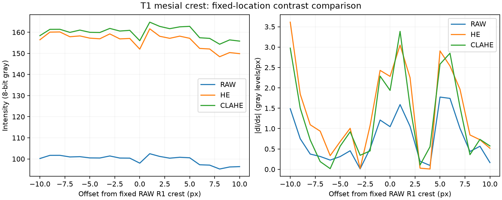
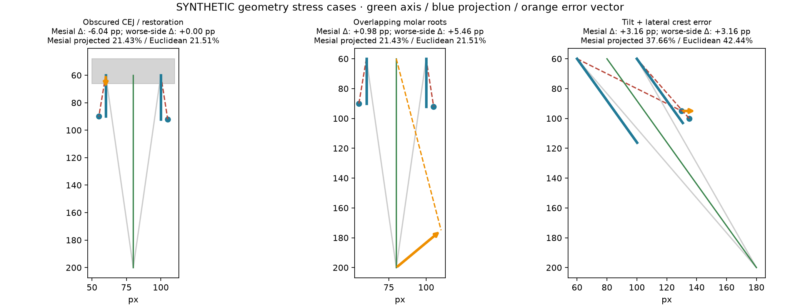

# Week 3: Repeatability and Image Contrast in the PBL Calculator

## Introduction

For Week 3, I continued working on the PBL calculator from Week 2. I wanted to see how much my measurements changed when I marked the same teeth again, and whether Raw, global histogram equalization (HE) or CLAHE affected landmark placement. I also added checks for invalid geometry and a way to export the measurements.

I measured the same 15 teeth on one panoramic image in two rounds under all three conditions. This gave 90 tooth readings and 180 surface observations. The [JSON](exports/measurements.json) and [CSV](exports/measurements.csv) contain the same readings, with no missing or duplicate tooth/condition/round combinations.

## Methods

### Measurements and reading order

Each reading used a mesial CEJ, mesial bone crest, distal CEJ, distal bone crest and one shared anatomical apex. Coordinates stayed in the original 2041 × 1024 image grid. Global HE used `equalizeHist`; CLAHE used a clip limit of 2.0 and an 8 × 8 tile grid. I interpreted the assignment's “tile grid = 88” as 8 × 8.

I restarted RAW Round 1 after I had placed mesial and distal on the wrong image side for eight teeth: T4–T7 and T12–T15, on the image-left side of the dental midline. The [earlier readings](protocol_history/excluded_raw_round1.json) were archived and excluded from the analysis. The [history record](protocol_history/history_evidence.json) preserves the reason and timing evidence.

The analyzed rounds were about 13 hours apart on 23 October 2026. Round 1 was bounded by study creation at 04:26 UTC and the completed backup at 04:49 UTC; Round 2 saves ran from 17:47 to 18:00 UTC. Both rounds followed Raw → HE → CLAHE. The second round took about 13 minutes from first to last save. Its tooth order matched the program's shuffled order; the first-round tooth order could not be verified.

### Calculation

The unit axis runs from the midpoint of the two CEJs toward the apex:

```text
m = (CEJ_mesial + CEJ_distal) / 2
u = (apex − m) / ||apex − m||
d_k = (BC_k − CEJ_k) · u
L_k = (apex − CEJ_k) · u
PBL_k = 100 × |d_k| / |L_k|
PBL_max = max(PBL_mesial, PBL_distal)
```

The engine checks `L_k > 0` and `0 ≤ d_k ≤ L_k` before taking absolute values. Undefined axes, invalid coordinates and out-of-range crests raise specific errors. Collinear points are allowed when the axis and projected lengths remain valid. The worse side determines the assignment stage: I below 15%, II from 15% to 33% inclusive, and III/IV above 33%.

I compared rounds with ICC(2,1), quadratic weighted kappa and Bland–Altman plots. Differences are Round 2 minus Round 1, in percentage points (pp). The LoA are mean bias ± 1.96 × sample SD (`ddof=1`). Kappa uses the ordered classes I, II and III/IV with disagreement weights `(i−j)²/4`.

## Results

### Agreement between rounds

Each condition contains 15 paired teeth, or 30 paired surfaces.

{{agreement}}

CLAHE had the highest observed ICC, while HE had the highest stage kappa. The mean differences were small, but the limits of agreement were still roughly ±11 pp. This means that the average change alone did not describe how much individual readings could differ.







I also compared whole-tooth PBLmax and resampled whole teeth 10,000 times (seed 20261023), keeping both surfaces and rounds together. The last column below is the clustered interval for the **surface ICC**, not the tooth PBLmax ICC.

{{tooth}}

Tooth-level plots: [Raw](raw/tooth_bland_altman.png), [HE](he/tooth_bland_altman.png), [CLAHE](clahe/tooth_bland_altman.png). Full results are in [supplementary_statistics.json](supplementary_statistics.json).

### Stage agreement

No tooth was Stage I in either round, so the observed tooth comparisons only distinguished II and III/IV. The table shows Round 1 → Round 2 counts; the [full three-class matrices](tooth_stage_confusion.csv) include the zero Stage I cells.

{{confusion}}

The differences between conditions involved only a few teeth. Eleven of the 180 surface observations, covering eight distinct tooth surfaces, were within 1 pp of a stage boundary. Small changes near 15% or 33% could therefore change a category. Forty-two of the 90 readings were above 33%, so the engine raised the furcation/vertical-defect review flag for them.

### Landmark placement across conditions

{{contrast}}

There were 30 complete tooth/round groups with all three conditions. Coordinate RMSD is `sqrt(mean(dx²+dy²))` across the five landmarks. With two rounds, the reported coordinate variance equals RMSD²/2, so those two columns describe the same variation. HE had the lowest observed round-to-round displacement.

I separated landmark displacement into its mean drift and centered residual. The full CSV files also contain parallel and normal components.

{{displacement}}

The apex had the largest RMS displacement in Raw and CLAHE, while the mesial CEJ had the largest in HE. The CLAHE apex moved an average of about 5.5 px parallel to the axis toward the root, which was worth reviewing even though the overall PBL bias was small.

### Sensitivity to point placement

I moved one landmark at a time by ±2, ±5 or ±10 px, parallel or normal to the starting axis, and recalculated the axis and both percentages. The 45 Round 1 geometries produced 2,700 simulated trials, kept separate from the saved readings. Invalid placements would be recorded as rejected trials.

{{sensitivity}}

### Five cases with the largest differences

I ranked each tooth by its largest absolute bias-centered surface difference across conditions. The five figures below show the responsible condition, both rounds' PBL values, the saved axis and crest projections. Cyan is Round 1, orange is Round 2, and arrows show the observed displacement.

Only four surface differences were outside their condition-specific LoA: {{flags}} The five ranked teeth are therefore review cases, not five claimed outliers.

The combined table shows the maximum absolute change in PBLmax, in pp, across five one-landmark **parallel** trials at each signed shift. All 200 case-level ±5/±10 px trials, including normal shifts and both surface changes, remain in [case_sensitivity.csv](case_sensitivity.csv).

{{case_sensitivity}}

Some shifts are asymmetric because a large change can make the other surface the worse side.

{{case_figures}}

T7's ranked figure uses Raw. Its HE mesial reading was also outside LoA, so I included [that condition's overlay](he_t7_flag.png) separately.

### Image gradients near the bone crest

I kept the Raw Round 1 crest locations fixed across transforms and sampled ±10 px perpendicular to the line joining the two crests. This line was an approximate tangent. I also checked the restricted ±3 px region because the strongest gradient could be away from the selected crest.

{{edges}}

HE and CLAHE stretched the grayscale range, so a larger unnormalized gradient was expected and could include noise. I used this as a contrast comparison, rather than evidence of a more accurately located bone boundary.



### Radiographic examples

The [image appendix](radiographic_cases/RADIOGRAPHIC_CASES.md) shows a restoration affecting CEJ identification (Week 2 img10-T3), an upper molar with partly superimposed root outlines (current T9), and an angulated tooth (current T7). The vectors use saved coordinates. The restoration example retains its older six-point format and is outside the main statistics.

I also used separate synthetic examples to show the effects of a shifted CEJ, a different apex selection and lateral displacement in a tilted tooth. In the first example, mesial PBL changes even though the worse-side maximum stays the same.



## Discussion and Limitations

The 95% tooth-cluster bootstrap intervals for mean surface bias were {{bias_intervals}}. All included zero, so I did not find clear evidence of an overall directional PBL shift in this sample. Mean landmark drift was smaller than the centered residual variation. This suggests that much of the change varied from tooth to tooth, but it does not establish that the error was purely random; the CLAHE apex drift still needed attention.

This was a small study with one reader and one image. The earlier RAW attempt, short interval and fixed condition order could introduce practice or recall effects, so the condition differences cannot be attributed to enhancement alone. The two surfaces also share a tooth and apex. No acceptable difference was set in advance, and expert reference landmarks were unavailable. The image-case labels are visual interpretations. These results are not clinical validation.

The optional crown point enables a warning for root-to-crown ratios below 1.0 or above 2.5, but it is not saved in the required five-landmark export. These records therefore cannot verify a measured root-to-crown ratio. Future work could use more images and readers, a planned interval and rotated condition order, with expert review of difficult landmarks.

## Software and Reproduction

{{test_summary}}

Saved evidence: [Week 3 tests](week3_test_results.txt), [project tests](project_test_results.txt), [frontend tests](frontend_test_results.txt) and [coverage](full_coverage.json). Setup and report-generation commands are in the [Week 3 README](../../README.md).

## Conclusion

I completed the two-round, three-condition measurements and used them to examine agreement, landmark displacement and sensitivity to small placement changes. CLAHE had the highest observed ICC, while HE had the highest stage agreement and lowest observed coordinate variation. Individual differences remained larger than the small mean bias suggested. The study helped identify areas for improving the measurement process, but did not establish which enhancement was most accurate or provide clinical validation.

GitHub and the current PR: [my submission links](SUBMISSION.md).

## References

- [ICC definitions](https://pingouin-stats.org/generated/pingouin.intraclass_corr.html)
- [Quadratic weighted kappa](https://scikit-learn.org/stable/modules/generated/sklearn.metrics.cohen_kappa_score.html)
- [OpenCV histogram equalization and CLAHE](https://docs.opencv.org/4.13.0/d5/daf/tutorial_py_histogram_equalization.html)
- [Sample image attribution](../../../week2/sample_xrays/README.md)
- [Week 3 assignment](ASSIGNMENT_REQUIREMENTS.txt)
