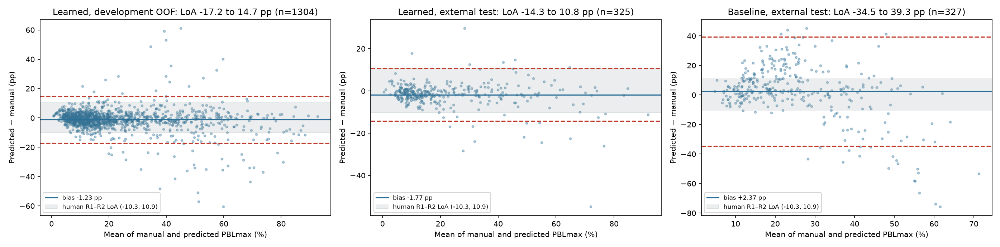
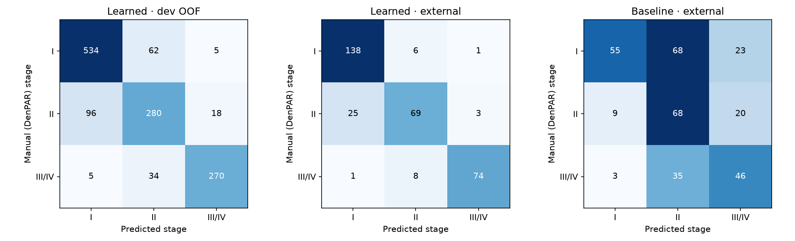

# Downstream clinical agreement: predicted vs manual PBL and stage

Predicted landmarks go through the unchanged Week 3 `calculate_tooth_pbl`
(long-axis projection, worse side, I < 15% ≤ II ≤ 33% < III/IV). They are
compared with the same engine applied to DenPAR's manual landmarks. Differences
are predicted − manual, in percentage points (pp), on tooth-level PBLmax. ICC
is ICC(2,1), absolute agreement. κ is quadratic weighted over the three ordered
classes. LoA = bias ± 1.96 SD. The 95% CIs resample whole radiographs, 2,000
times.

## Summary

| | Baseline, dev (OOF) | Learned Raw, dev (OOF) | Learned Raw, **external** | Learned CLAHE, external | **Me, R1 vs R2 (RAW)** |
| --- | ---: | ---: | ---: | ---: | ---: |
| Teeth (valid / total) | 1,325 / 1,330 | 1,304 / 1,330 | 325 / 327 | 324 / 327 | 15 |
| ICC(2,1) PBLmax | 0.36 (0.31–0.41) | 0.90 (0.88–0.93) | **0.94 (0.90–0.96)** | 0.94 | 0.69 |
| ICC, mean ± SD over folds | 0.37 ± 0.07 | 0.91 ± 0.02 | — | — | — |
| Weighted κ, stage | 0.35 | 0.85 | **0.89** | 0.89 | 0.44 |
| Bias | +3.76 pp | −1.23 pp | **−1.77 pp** | −1.61 pp | +0.32 pp |
| 95% LoA | −33.0 to +40.5 | −17.2 to +14.7 | **−14.3 to +10.8** | −14.2 to +11.0 | −10.3 to +10.9 |
| LoA width | 73.4 pp | 31.9 pp (27.7–35.9) | **25.1 pp (19.1–31.3)** | 25.3 pp | 21.2 pp |
| PBL MAE | 13.9 pp | 4.65 pp | 3.91 pp | — | — |
| Stage accuracy | 0.48 | 0.83 | 0.87 | 0.86 | — |

## Model vs my own repeatability

The model's limits of agreement are **wider than my own round-to-round limits**:

- **External test**: 25.1 vs 21.2 pp, **3.9 pp (18%) wider**. The radiograph-level
  bootstrap interval for the model's width (19.1–31.3 pp) contains 21.2, so on
  these data the difference is not clearly distinguishable from zero.
- **Development, out-of-fold**: 31.9 vs 21.2 pp, **10.7 pp (51%) wider**. Its
  interval (27.7–35.9) excludes 21.2. Each development tooth is predicted by a
  single fold model, while the external set uses the five-model average, which is
  why the external numbers are better.

The ICC and κ are higher for the model than for me (0.94 vs 0.69; 0.89 vs 0.44).
That does **not** mean the model is "more reliable than a human". ICC depends on
the spread of the true values: DenPAR spans 0–95% PBL, while my 15 teeth all fall
in a narrow range with no Stage I, which lowers my ICC for the same absolute
error. **LoA width is the fair comparison, and on it the model is somewhat
worse.** The comparison is also indirect: different images (periapical vs
panoramic), different references (DenPAR's annotation vs my other round), and only
15 human pairs, whose LoA have a wide unquantified uncertainty.

## Stage confusion matrices

Rows are the manual stage, columns the predicted stage.

| Learned Raw, external | Pred I | Pred II | Pred III/IV |
| --- | ---: | ---: | ---: |
| **Manual I** (145) | 138 | 6 | 1 |
| **Manual II** (97) | 25 | 69 | 3 |
| **Manual III/IV** (83) | 1 | 8 | 74 |

| Learned Raw, development OOF | Pred I | Pred II | Pred III/IV |
| --- | ---: | ---: | ---: |
| **Manual I** (601) | 534 | 62 | 5 |
| **Manual II** (394) | 96 | 280 | 18 |
| **Manual III/IV** (309) | 5 | 34 | 270 |

**Direction of errors: the model systematically under-calls.**

- External: 34 teeth called a lower stage vs 10 called higher. Development: 135
  lower vs 85 higher.
- **III/IV under-called: 9 / 83 (10.8%) external, 39 / 309 (12.6%) development.**
  Nearly all of these go to Stage II, not Stage I (1 and 5 cases respectively).
- The largest single error cell is **II → I** (25 external, 96 development):
  early bone loss read as none.
- The cause is visible in the landmarks: on the external test, the predicted crest lies on average
  **2.2 px coronal** to DenPAR's (signed along-axis error), and the mean PBL bias is
  −1.2 to −1.8 pp. A slight coronal crest bias removes bone loss, and near the
  15% and 33% boundaries that flips the stage down.

Under-calling severe disease is the clinically dangerous failure, and this model
does it about one time in nine. Accepting only the teeth that pass the
[rejection rule](UNCERTAINTY_REJECTION.md) reduces external III/IV under-calls
from 9 to 1, but 25% of teeth then go to manual review.

## Anatomically invalid outputs (Week 3 guardrails)

All predictions pass through the same engine as manual entries, so the Week 3
guardrails apply unchanged:

| Detector / split | Invalid | Error type |
| --- | ---: | --- |
| Learned Raw, development | 26 / 1,330 (2.0%) | `BoneCrestBoundsError` (crest predicted coronal to the CEJ or beyond the apex) |
| Learned Raw, external | 2 / 327 (0.6%) | `BoneCrestBoundsError` |
| Learned CLAHE, development / external | 14 (1.1%) / 3 (0.9%) | 13 `BoneCrestBoundsError`, 1 `DegenerateGeometryError` |
| Baseline, development / external | 5 (0.4%) / 0 | 1 `BoneCrestBoundsError`, 4 `DegenerateGeometryError` |

Invalid predictions are **not** counted as zero bone loss, and they are excluded
from ICC/κ. The tables report "valid / total" so the denominator stays visible. In
the App they raise a typed error, and the reader is told to measure that tooth by
hand. Three of the five worst predictions were invalid
([failure report](FAILURE_ROBUSTNESS.md)), so the guardrail catches some, but not
all, gross failures.

Numbers: `results/metrics.json` → `downstream_pooled`,
`downstream_pooled_clustered_ci95`, `human_reference_week3`,
`invalid_predictions`.
