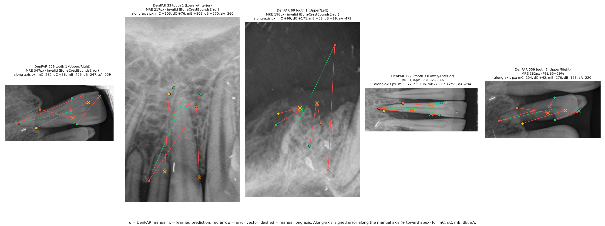
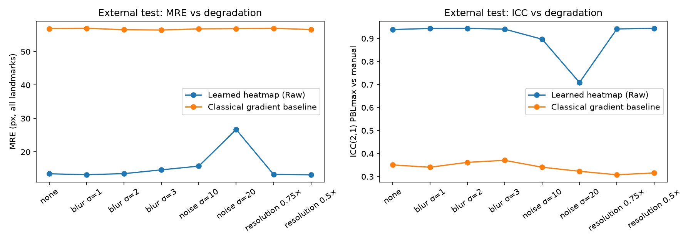

# Failure analysis and robustness

The learned model is trained on Raw input unless stated otherwise. Subgroup CIs
resample whole radiographs, 2,000 times. Subgroups are descriptive and
overlapping (one tooth can be both tilted and multi-rooted), and no multiplicity
correction is applied.

## Five worst predictions (development, out-of-fold)

| DenPAR image / tooth | Arch / site | MRE px | Manual → predicted PBL | Orientation error | Max σ | What went wrong |
| --- | --- | ---: | --- | ---: | ---: | --- |
| 559 / 1 | Upper / Right | 347 | 71% → invalid | 102° | 158 px | Radiograph stored **rotated 90°**: the "apex up" input points sideways, so the crop puts the crown on its side |
| 33 / 1 | Lower / Anterior | 217 | 13% → invalid | 23° | 176 px | Partially visible incisor with overlap. Diffuse heatmaps; the soft-argmax collapses toward the crop centre, apex predicted coronally |
| 88 / 1 | Upper / Left | 196 | 25% → invalid | 25° | 148 px | Long, tilted root reaching the top of a large box. Apex heatmap diffuse, predicted on the crown side |
| 1226 / 3 | Lower / Anterior | 184 | 92% → 93% | 91° | 220 px | **Rotated 90°**. Every landmark is wrong, yet the stage comes out correct by coincidence: the prediction is "right for the wrong reason" |
| 559 / 2 | Upper / Right | 182 | 65% → 29% | 102° | 150 px | Same rotated radiograph as the first row. **Severe disease under-called** as Stage II |

Patterns in these five:

1. **Orientation is the dominant gross failure.** The two inputs "apex up/down"
   and "mesial left/right" cannot describe a radiograph rotated 90°. Across all 84
   development teeth whose arch label contradicts the visible orientation by more
   than 45°, MRE is **37.7 px (24.9–53.3) vs 13.9 px (13.1–14.7)** otherwise, and
   stage accuracy is 0.72 vs 0.84.
2. **Every one of the five was very uncertain.** Maximum σ was ≥ 148 px, against a
   median of 11 px. All five would be flagged by any σ-based rule. Three of them
   are also rejected by the Week 3 geometric guardrail (`BoneCrestBoundsError`).
3. **The along-axis component carries the damage.** In row 5, the crests moved
   276 px and 178 px coronally along the manual axis
   (`mesial_bc −276, distal_bc −178`), which turns 65% into 29%.

## Subgroups

| Subgroup | Split | n teeth / images | MRE px (95% CI) | Along-axis MAE px | PBL MAE pp | Stage accuracy (95% CI) | Invalid | III/IV under-called |
| --- | --- | --- | --- | ---: | ---: | --- | ---: | --- |
| All | external | 327 / 180 | 13.5 (12.0–15.0) | 11.1 | 3.9 | 0.87 (0.82–0.90) | 0.6% | 9 / 83 |
| Multi-rooted (≥2 apices) | external | 122 / 97 | 12.1 (10.9–13.5) | 10.0 | 3.9 | 0.84 (0.76–0.91) | 0% | 3 / 15 |
| Tilted >15° | external | 85 / 62 | 16.4 (12.6–21.0) | 13.4 | 5.0 | 0.81 (0.73–0.89) | 1.2% | 2 / 15 |
| Low contrast (bottom quartile, RMS ≤ 0.111) | external | 80 / 50 | 11.5 (10.2–12.8) | 9.7 | 2.9 | 0.90 (0.83–0.96) | 0% | 2 / 18 |
| Anterior site | external | 91 / 45 | 15.5 (12.5–19.1) | 13.7 | 4.3 | 0.89 (0.81–0.96) | 1.1% | 4 / 53 |
| Orientation metadata wrong | external | 5 / 2 | 60.0 | 52.7 | 15.4 | (n too small) | 0% | 0 / 3 |
| All | development | 1,330 / 727 | 15.4 (14.2–16.8) | 12.6 | 4.7 | 0.83 (0.81–0.85) | 2.0% | 39 / 309 |
| Multi-rooted | development | 424 / 333 | 14.0 (13.1–14.9) | 11.0 | 5.0 | 0.81 (0.76–0.84) | 2.1% | 12 / 52 |
| Tilted >15° | development | 277 / 221 | 21.1 (16.5–26.7) | 16.9 | 5.3 | 0.79 (0.74–0.83) | 4.3% | 7 / 51 |
| Low contrast | development | 333 / 210 | 14.6 (12.6–17.0) | 11.6 | 4.0 | 0.86 (0.82–0.90) | 1.2% | 5 / 73 |
| Orientation metadata wrong | development | 84 / 38 | 37.7 (25.0–53.3) | 31.6 | 9.1 | 0.72 (0.61–0.82) | 7.1% | 5 / 20 |
| **Obscured CEJ (restoration / crown)** | — | **not estimable** | | | | | | |

How to read this table, honestly:

- **Tilted teeth are the clearest real weakness.** Their MRE is 22–37% higher than
  overall, their stage accuracy is lower, and their invalid rate doubles on
  development. Tilt also correlates with the rotated-image failures above.
- **Multi-rooted molars are *not* worse on landmark error.** That is partly by
  construction: the ground-truth apex is the mean of the annotated apices, so the
  model learns a stable midpoint, and the axial definition hides the root
  ambiguity. Their stage accuracy is slightly lower, but the CIs overlap with the
  overall value. With only 15 external III/IV molars, the 3 under-calls cannot be
  given a meaningful rate.
- **Low contrast did not hurt.** The bottom-quartile teeth are slightly *better*.
  "Low RMS contrast" mostly picks out evenly exposed films, not the washed-out ones
  a clinician means. This proxy is weak.
- **Obscured CEJ could not be studied.** DenPAR has no restoration or crown labels.
  Two pixel-based proxies (saturation near the CEJ, crown radiopacity) were tried
  and rejected after visual inspection, because their top hits were film markers,
  wires and image borders. Rather than report a misleading number, this subgroup
  is left empty. The App's "Obscured CEJ" tag on saved reviews is how these labels
  would be collected.
- Several external subgroups have fewer than 100 teeth from fewer than 65 images,
  so their intervals are wide. Differences of 1–3 px between subgroups are within
  noise.

## Robustness to image degradation (external test)

Each degradation is applied to the whole radiograph before cropping. Blur is a
Gaussian with radius σ; noise is additive Gaussian in gray levels with a fixed
seed per image; reduced resolution means downscaling, then upscaling back to the
original grid, so coordinates stay comparable.

| Degradation | Learned MRE px | Learned ICC | Learned stage accuracy | Baseline MRE px | Baseline ICC |
| --- | ---: | ---: | ---: | ---: | ---: |
| None | 13.5 | 0.939 | 0.865 | 56.9 | 0.351 |
| Blur σ = 1 / 2 / 3 | 13.2 / 13.5 / 14.6 | 0.944 / 0.944 / 0.941 | 0.887 / 0.868 / 0.871 | 57.0 / 56.5 / 56.5 | 0.341 / 0.362 / 0.371 |
| Noise σ = 10 | 15.8 | 0.897 | 0.815 | 56.8 | 0.341 |
| **Noise σ = 20** | **26.7** | **0.709** | **0.705** | 56.9 | 0.323 |
| Resolution 0.75× / 0.5× | 13.3 / 13.2 | 0.941 / 0.944 | 0.874 / 0.883 | 57.0 / 56.6 | 0.308 / 0.316 |

- **Blur and halved resolution barely matter.** That is expected: the detector
  already shrinks the median 257 × 621 px tooth box (plus margin) to 160 × 320,
  about 1.9–2.3× downsampling, so these degradations remove detail the model never sees. The same
  fact explains the SDR@2 px ceiling in the [detector report](DETECTOR_COMPARISON.md).
- **Noise is the weakness.** At σ = 20 gray levels, MRE doubles, ICC drops from
  0.94 to 0.71, and stage accuracy drops by 16 points. Noise was not part of
  training augmentation, so adding it is the obvious fix.
- The baseline looks "robust" only because it is mostly the mean shape and ignores
  most of the image.

## Raw vs CLAHE

Five fold models were trained on each input. All four train/test combinations
were run on the external set (5-model ensembles):

| Trained on → tested on | MRE px | Crest along-axis MAE px | Mean signed crest error (+ = apical) | PBL bias | ICC | LoA width |
| --- | ---: | ---: | ---: | ---: | ---: | ---: |
| Raw → Raw | 13.45 | 12.6 | −2.2 px | −1.77 pp | 0.939 | 25.1 pp |
| Raw → CLAHE | 13.66 | 12.9 | **+2.0 px** | −0.66 pp | 0.956 | 22.3 pp |
| CLAHE → Raw | 14.13 | 14.0 | **−4.8 px** | −1.97 pp | 0.929 | 27.0 pp |
| CLAHE → CLAHE | 13.38 | 13.0 | −1.7 px | −1.61 pp | 0.941 | 25.3 pp |

Development 5-fold, matched input: Raw MRE 15.4 ± 1.6 px, ICC 0.905 ± 0.016;
CLAHE MRE 15.3 ± 1.4 px, ICC 0.912 ± 0.028. The fold SDs overlap: **no
difference**.

**Connection to Week 3.** In Week 3, CLAHE roughly doubled the crest-edge
gradient (7.4 vs 3.9 gray/px). My own round-to-round limits did not narrow,
though (about ±11 pp under every condition), so I concluded that a sharper edge
does not by itself mean a more accurate boundary. The model results support
that, and add a direction:

- **Matched training and testing:** CLAHE neither helps nor hurts. A sharper
  edge did not translate into a more accurate crest.
- **Mismatched input:** the crest moves systematically. A Raw-trained model
  shown CLAHE places the crest **about 4 px more apically** (−2.2 → +2.0 px). A
  CLAHE-trained model shown Raw places it about 3 px more coronally. So CLAHE does
  not just stabilize the boundary; it **shifts where the boundary appears to be**,
  by a few pixels along the axis, which is the direction that moves PBL%.
- Raw → CLAHE happened to give the best external ICC (0.956) and the narrowest LoA
  (22.3 pp), because its apical shift cancels the model's coronal bias. **This is
  a post-hoc observation on the test set, so I do not adopt it.** Adopting it
  would mean tuning on external data. Whether a deliberate apical offset (or a
  CLAHE input) reduces under-calling should be tested prospectively on new data.
- For the App, this means the display condition and the model's input condition
  must be kept separate. The learned model always receives the preprocessing it
  was trained with (`LearnedHeatmapDetector.condition`), whatever the reader
  chooses to view.

Numbers: `results/metrics.json` → `worst_five_development`, `subgroups`,
`robustness_external`, `raw_vs_clahe_external`.
