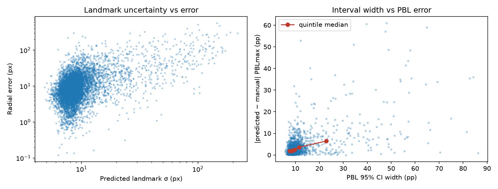
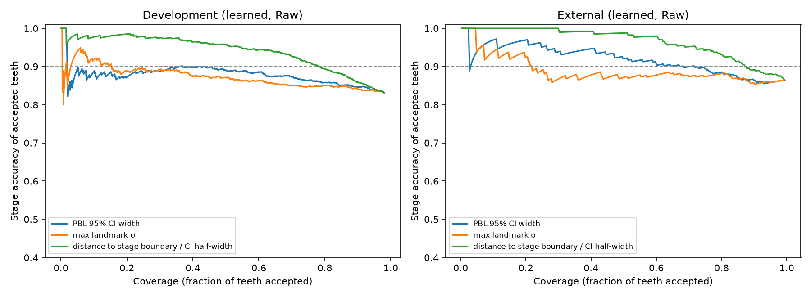

# Uncertainty estimation and rejection

## Method

- **Landmark uncertainty** is the spatial SD of each softmax heatmap, mapped back
  to original pixels as an isotropic 1-SD radius. On the external test it is
  combined with the variance between the five fold models' coordinates. This is
  the "heatmap peak sharpness" option. No extra forward passes are needed.
- **PBL interval**: 1,000 Monte Carlo draws, each landmark moved independently by
  N(0, σ²) and passed through the Week 3 engine. Anatomically invalid draws are
  dropped, and the 2.5th–97.5th percentiles of the valid draws form the 95%
  interval. If fewer than 20% of draws are valid, the tooth gets no interval and
  is always referred.
- **Does uncertainty predict error?** Spearman ρ between predicted σ and the
  observed radial error, and between interval width and |PBL error|. Coverage of
  the nominal 95% interval is also checked.

## Does it predict error?

| | Development OOF (n = 1,304) | External (n = 325) | Baseline, external |
| --- | ---: | ---: | ---: |
| ρ(landmark σ, radial error), all landmarks pooled | **0.39** | **0.42** | 0.30 |
| ρ per landmark: mesial CEJ / distal CEJ | 0.23 / 0.26 | 0.25 / 0.37 | |
| ρ per landmark: mesial BC / distal BC / apex | 0.40 / 0.47 / 0.50 | 0.43 / 0.46 / 0.49 | |
| ρ(PBL CI width, \|PBL error\|) | 0.37 | 0.36 | 0.29 |
| Pearson r(CI width, \|PBL error\|) | 0.55 | 0.55 | |
| Median CI width | 9.7 pp | 10.5 pp | 66 pp |
| **Empirical coverage of the nominal 95% CI** | **80%** | **87%** | 80% |
| Median (radial error / σ); 1.18 if calibrated | 1.00 | 0.82 | |

**Yes, moderately.** Uncertainty is clearly related to error: the quintile with
the widest intervals has about 3–4× the median PBL error of the narrowest. The
signal is strongest exactly where it matters, at the crests and apex (ρ ≈ 0.4–0.5),
and weakest for the CEJs (ρ ≈ 0.25). The baseline's uncertainty (the shape prior)
is less informative.

**But the intervals are too narrow.** A "95%" interval contains the manual PBL in
only 80–87% of teeth. Per-landmark σ is roughly the right size (median
error/σ ≈ 0.8–1.0, against 1.18 for a calibrated isotropic Gaussian). The interval
is too narrow because the Monte Carlo step treats the five landmark errors as
independent. Real errors are correlated: for example, a whole crop shifted
along the axis, or the shared coronal crest bias. The interval also ignores
DenPAR's own annotation noise. So the interval width should be used as a
**ranking score, not as a calibrated probability**. Conformal recalibration on
development folds would be the next step.

## Rejection rules

**The prespecified rule fails.** The rule written before evaluation (refer if the
CI crosses 15% or 33%, **or** any landmark σ > 5 px) refers **100%** of teeth.
The model's smallest σ is 6.8 px and its median maximum σ is 11–12 px, so on
these ~1,170 × 890 px images, 5 px is below the model's resolution floor. I
report this as specified rather than quietly changing it.

**Risk–coverage.** Teeth are sorted by a score, and the fraction accepted is
plotted against the stage accuracy of the accepted teeth:

| Score used to sort teeth | Max coverage with ≥ 90% stage accuracy, dev | External |
| --- | ---: | ---: |
| Maximum landmark σ | 15% | 22% |
| PBL 95% CI width | 44% | 72% |
| **Distance to nearest stage boundary ÷ CI half-width** | **78%** | **87%** |

Ranking by raw uncertainty alone barely raises accuracy. Most stage errors are
not on high-uncertainty teeth; they are on teeth that sit **near a boundary**.
The score that combines the interval with the stage boundaries works much
better.

**Proposed rule**, tuned on development only, then frozen and applied once to
the external set:

> **Accept** the suggested stage only if the prediction is anatomically valid
> **and** |PBLmax − nearest stage boundary| ≥ **0.45 × the 95% CI half-width**.
> Otherwise flag the tooth for manual measurement.
> *k* = 0.45 is the smallest value that gives ≥ 90% stage accuracy on development.

| | Coverage | Stage accuracy (accepted) | PBL MAE (accepted) | III/IV under-called among accepted |
| --- | ---: | ---: | ---: | ---: |
| No rule, external | 100% (327) | 86.5% | 3.91 pp | 9 |
| **Margin rule, development** | 77.4% (1,029 / 1,330) | 90.4% | 4.28 pp | 13 |
| **Margin rule, external** | **74.9% (245 / 327)** | **94.3%** | 3.30 pp | **1** |
| CI crosses a boundary → refer, external | 45.3% | 99.3% | 3.33 pp | 1 |

**Justification.** The margin rule meets the ≥ 90% target on data it was not
tuned on. It keeps three quarters of the workload automated and cuts accepted
severe under-calls from 9 to 1. The stricter "any boundary crossing" rule is
safer but refers more than half of all teeth. Both rules still accept some errors,
so even accepted teeth stay reviewable in the App.

**In the App.** `predict_landmarks` now applies the margin rule
(`uncertainty.needs_review_by_margin`, `MARGIN_K = 0.45`). The prespecified rule
would flag every tooth, which trains readers to ignore the flag. A flagged tooth
shows the reason (for example "PBL 14.0% is 1.0 pp from the 15% boundary…") and
needs all five landmarks confirmed before export. The rule has been validated
only retrospectively on one dataset. It is a triage aid, not a safety guarantee.

Numbers: `results/metrics.json` → `uncertainty`, `uncertainty_baseline`; curves
in `results/risk_coverage_curves.json`.
