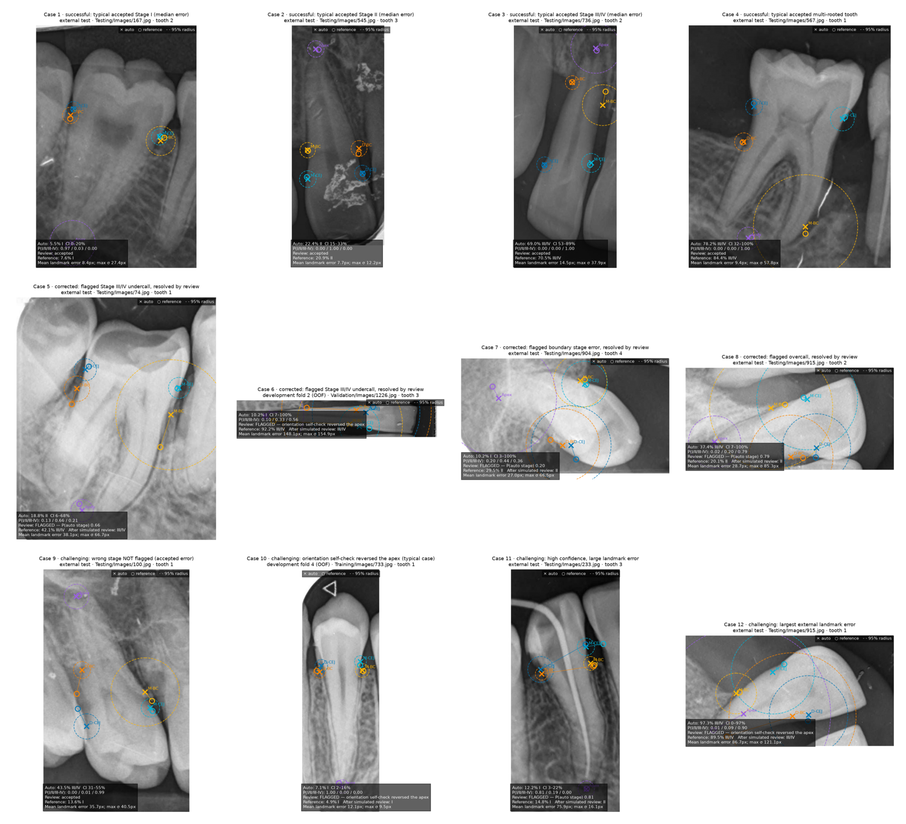

# Clinical error analysis

All figures and tables come from `python -m week5.evaluate`. The external test (327 teeth) was scored
once, after every parameter was frozen. Development rows are cross-fitted out-of-fold.

## Stage errors on the external test

| Reference ↓ · Auto → | I | II | III/IV |
|---|---:|---:|---:|
| I | 139 | 6 | 1 |
| II | 23 | 66 | 8 |
| III/IV | 0 | 7 | 77 |

## False-negative staging: every Stage III/IV tooth called I/II

Flagged by the review rule: 6/7 external and
34/36 development teeth. "Fixed by" lists the single landmarks that would correct
the stage if moved to the reference position. "After review" is the stage after one simulated correction
(see below).

**External test**

| Set | Image / tooth | True PBL | Auto | P(III/IV) | Flagged | Reason | Fixed by | After review | Anatomy |
|---|---|---:|---|---:|---|---|---|---|---|
| external | Testing/Images/54.jpg / 1346 | 35% | 31% II | 0.23 | **yes** | P(auto stage) 0.78 | ≥2 landmarks | II | anterior |
| external | Testing/Images/54.jpg / 1348 | 33% | 30% II | 0.50 | **yes** | P(auto stage) 0.50 | apex | II | anterior |
| external | Testing/Images/68.jpg / 1351 | 34% | 32% II | 0.62 | **yes** | P(auto stage) 0.38 | mesial_bc | II | anterior |
| external | Testing/Images/68.jpg / 1352 | 35% | 31% II | 0.31 | **yes** | P(auto stage) 0.69 | distal_bc | II | anterior |
| external | Testing/Images/74.jpg / 1353 | 42% | 19% II | 0.21 | **yes** | P(auto stage) 0.66 | mesial_bc | III/IV | multi-rooted tilted |
| external | Testing/Images/756.jpg / 1518 | 40% | 26% II | 0.15 | **yes** | P(auto stage) 0.85 | distal_bc | II | multi-rooted |
| external | Testing/Images/907.jpg / 1564 | 44% | 22% II | 0.01 | no | — | distal_bc | — | — |

Development (cross-fitted), 36 teeth

| Set | Image / tooth | True PBL | Auto | P(III/IV) | Flagged | Reason | Fixed by | After review | Anatomy |
|---|---|---:|---|---:|---|---|---|---|---|
| development | Training/Images/12.jpg / 11 | 34% | 26% II | 0.01 | no | — | ≥2 landmarks | — | — |
| development | Training/Images/26.jpg / 24 | 34% | 25% II | 0.08 | **yes** | P(auto stage) 0.92 | ≥2 landmarks | II | — |
| development | Training/Images/59.jpg / 62 | 38% | 31% II | 0.28 | **yes** | P(auto stage) 0.72 | distal_bc | II | — |
| development | Training/Images/94.jpg / 98 | 34% | 30% II | 0.25 | **yes** | P(auto stage) 0.75 | apex | II | — |
| development | Training/Images/101.jpg / 103 | 92% | invalid | n/a | **yes** | no valid automatic measurement — measure manually | — | III/IV | multi-rooted tilted |
| development | Training/Images/235.jpg / 171 | 41% | 22% II | 0.00 | no | P(auto stage) 0.94 | distal_bc | — | multi-rooted |
| development | Training/Images/562.jpg / 380 | 40% | 21% II | 0.02 | **yes** | P(auto stage) 0.86 | mesial_bc | III/IV | anterior |
| development | Training/Images/645.jpg / 458 | 38% | 31% II | 0.33 | **yes** | P(auto stage) 0.67 | mesial_bc | II | tilted |
| development | Training/Images/777.jpg / 584 | 55% | 32% II | 0.46 | **yes** | orientation self-check reversed the apex; P(auto stage) 0.54 | mesial_cej, mesial_bc, distal_bc, apex | III/IV | anterior |
| development | Training/Images/796.jpg / 597 | 48% | 24% II | 0.67 | **yes** | orientation self-check reversed the apex; P(auto stage) 0.30 | mesial_cej, mesial_bc | III/IV | tilted |
| development | Training/Images/905.jpg / 693 | 33% | 32% II | 0.41 | **yes** | P(auto stage) 0.59 | ≥2 landmarks | II | tilted |
| development | Training/Images/919.jpg / 704 | 37% | 17% II | 0.00 | **yes** | P(auto stage) 0.82 | ≥2 landmarks | II | multi-rooted |
| development | Training/Images/924.jpg / 713 | 33% | 32% II | 0.52 | **yes** | P(auto stage) 0.48 | distal_bc | II | anterior |
| development | Training/Images/926.jpg / 716 | 36% | 32% II | 0.54 | **yes** | P(auto stage) 0.46 | distal_cej, distal_bc | II | anterior |
| development | Training/Images/978.jpg / 761 | 36% | 31% II | 0.49 | **yes** | P(auto stage) 0.51 | mesial_cej, distal_cej | III/IV | anterior |
| development | Training/Images/987.jpg / 770 | 33% | 28% II | 0.09 | **yes** | P(auto stage) 0.91 | distal_bc | II | multi-rooted |
| development | Training/Images/1031.jpg / 818 | 48% | 31% II | 0.42 | **yes** | P(auto stage) 0.58 | distal_bc | III/IV | — |
| development | Training/Images/1111.jpg / 884 | 49% | 15% I | 0.01 | **yes** | P(auto stage) 0.48 | distal_bc | III/IV | multi-rooted tilted |
| development | Training/Images/1119.jpg / 892 | 45% | 21% II | 0.03 | **yes** | orientation self-check reversed the apex; P(auto stage) 0.93 | mesial_bc | III/IV | — |
| development | Training/Images/1179.jpg / 957 | 36% | 30% II | 0.27 | **yes** | P(auto stage) 0.73 | distal_cej, distal_bc | II | — |
| development | Training/Images/1179.jpg / 958 | 34% | 33% II | 0.72 | **yes** | P(auto stage) 0.28 | mesial_cej, distal_cej, apex | II | — |
| development | Validation/Images/48.jpg / 1087 | 44% | 31% II | 0.41 | **yes** | P(auto stage) 0.59 | mesial_cej, distal_cej | III/IV | anterior |
| development | Validation/Images/48.jpg / 1088 | 34% | 26% II | 0.08 | **yes** | P(auto stage) 0.92 | ≥2 landmarks | II | anterior |
| development | Validation/Images/50.jpg / 1090 | 34% | 27% II | 0.16 | **yes** | P(auto stage) 0.84 | ≥2 landmarks | II | — |
| development | Validation/Images/172.jpg / 1111 | 37% | 9% I | 0.00 | **yes** | P(auto stage) 0.79 | distal_bc | III/IV | multi-rooted tilted |
| development | Validation/Images/329.jpg / 1123 | 43% | 30% II | 0.21 | **yes** | P(auto stage) 0.79 | mesial_bc | III/IV | — |
| development | Validation/Images/556.jpg / 1159 | 44% | 31% II | 0.55 | **yes** | P(auto stage) 0.45 | mesial_bc | III/IV | multi-rooted |
| development | Validation/Images/559.jpg / 1163 | 65% | invalid | n/a | **yes** | no valid automatic measurement — measure manually | — | III/IV | tilted |
| development | Validation/Images/644.jpg / 1177 | 33% | 17% II | 0.09 | **yes** | P(auto stage) 0.54 | mesial_bc | III/IV | multi-rooted |
| development | Validation/Images/833.jpg / 1219 | 36% | 31% II | 0.26 | **yes** | P(auto stage) 0.74 | mesial_cej, mesial_bc | II | multi-rooted |
| development | Validation/Images/935.jpg / 1244 | 35% | 32% II | 0.40 | **yes** | P(auto stage) 0.60 | mesial_cej | II | tilted |
| development | Validation/Images/936.jpg / 1246 | 33% | 31% II | 0.37 | **yes** | P(auto stage) 0.63 | apex | II | multi-rooted |
| development | Validation/Images/1210.jpg / 1306 | 48% | 29% II | 0.35 | **yes** | P(auto stage) 0.65 | distal_bc | III/IV | — |
| development | Validation/Images/1226.jpg / 1310 | 61% | 31% II | 0.59 | **yes** | orientation self-check reversed the apex; P(auto stage) 0.38 | mesial_bc, distal_bc | III/IV | tilted anterior |
| development | Validation/Images/1226.jpg / 1311 | 92% | 10% I | 0.56 | **yes** | orientation self-check reversed the apex; P(auto stage) 0.10 | mesial_bc, distal_bc | III/IV | tilted anterior |
| development | Validation/Images/1226.jpg / 1312 | 62% | 20% II | 0.39 | **yes** | P(auto stage) 0.51 | mesial_bc, distal_bc | III/IV | tilted anterior |

## Which landmark causes stage errors?

Single-landmark fixes across all wrong stages: external Distal bone crest 15, Mesial bone crest 10, needs ≥2 landmarks 9, Mesial CEJ 8, Distal CEJ 8, Apex 4; development Distal bone crest 75, Mesial bone crest 47, needs ≥2 landmarks 39, Mesial CEJ 39, Distal CEJ 34, Apex 15.
The highest-σ landmark is itself a fix in 16/45 external and
71/195 development stage errors. Bone-crest placement
dominates, which confirms weakness 2 of the error analysis.

## Are errors more common for particular teeth or image conditions?

Tooth type is approximated by DenPAR's structured fields: multi-rooted (molar-like) versus single-rooted,
anterior versus posterior site, and arch. DenPAR has no FDI tooth number for every box, so no per-tooth-number claim is made.
Image conditions use pixel measures with cut-offs taken from the development quartiles: RMS contrast
≤ 0.111, and edge sharpness ≤ 3.3.

**External test**

| Subgroup | n | MRE px W4 → W5 | Stage acc. W4 → W5 | III/IV missed | Review rate | Accepted acc. | Accepted III/IV misses |
|---|---:|---:|---:|---:|---:|---:|---:|
| all | 327 | 13.5 → 13.0 | 86.5% → 86.2% | 7/84 | 50.8% | 98.8% | 1 |
| multi-rooted (molar-like) | 122 | 12.1 → 11.9 | 83.6% → 86.1% | 2/15 | 56.6% | 100.0% | 0 |
| single-rooted | 205 | 14.3 → 13.7 | 88.2% → 86.3% | 5/69 | 47.3% | 98.1% | 1 |
| anterior site | 91 | 15.5 → 14.2 | 88.9% → 86.8% | 4/54 | 46.2% | 100.0% | 0 |
| posterior site | 236 | 12.7 → 12.6 | 85.5% → 86.0% | 3/30 | 52.5% | 98.2% | 1 |
| maxillary | 123 | 14.7 → 14.2 | 86.2% → 84.6% | 0/28 | 52.8% | 98.3% | 0 |
| mandibular | 204 | 12.7 → 12.3 | 86.6% → 87.3% | 7/56 | 49.5% | 99.0% | 1 |
| tilted >15° | 85 | 16.4 → 16.4 | 81.0% → 84.7% | 1/15 | 63.5% | 96.8% | 0 |
| low contrast (dev bottom quartile) | 80 | 11.5 → 11.1 | 90.0% → 87.5% | 2/18 | 52.5% | 100.0% | 0 |
| blurred (dev bottom-quartile sharpness) | 87 | 11.8 → 11.5 | 87.2% → 86.2% | 3/24 | 47.1% | 100.0% | 0 |
| orientation metadata wrong (>45°) | 5 | 60.0 → 56.7 | 100.0% → 60.0% | 0/3 | 100.0% | n/a | 0 |

**Development (cross-fitted)**

| Subgroup | n | MRE px W4 → W5 | Stage acc. W4 → W5 | III/IV missed | Review rate | Accepted acc. | Accepted III/IV misses |
|---|---:|---:|---:|---:|---:|---:|---:|
| all | 1330 | 15.4 → 14.0 | 83.1% → 85.3% | 36/315 | 46.2% | 95.1% | 2 |
| multi-rooted (molar-like) | 424 | 14.0 → 13.0 | 80.5% → 82.9% | 10/53 | 50.7% | 92.3% | 1 |
| single-rooted | 906 | 16.0 → 14.5 | 84.4% → 86.4% | 26/262 | 44.0% | 96.3% | 1 |
| anterior site | 301 | 18.5 → 16.8 | 86.9% → 86.6% | 10/155 | 35.9% | 97.4% | 0 |
| posterior site | 1029 | 14.5 → 13.2 | 82.0% → 84.9% | 26/160 | 49.2% | 94.3% | 2 |
| maxillary | 578 | 15.5 → 14.0 | 84.4% → 87.0% | 11/136 | 46.2% | 96.5% | 0 |
| mandibular | 752 | 15.3 → 14.0 | 82.2% → 83.9% | 25/179 | 46.1% | 94.1% | 2 |
| tilted >15° | 277 | 21.1 → 19.4 | 78.5% → 80.9% | 11/55 | 59.6% | 92.9% | 0 |
| low contrast (dev bottom quartile) | 333 | 14.6 → 13.0 | 85.7% → 86.4% | 6/74 | 41.4% | 94.4% | 1 |
| blurred (dev bottom-quartile sharpness) | 333 | 16.5 → 14.3 | 83.0% → 84.6% | 13/110 | 44.4% | 95.1% | 1 |
| orientation metadata wrong (>45°) | 84 | 37.7 → 27.7 | 71.8% → 80.5% | 5/23 | 96.4% | 66.7% | 0 |

## Does manual correction resolve the errors?

Previously, corrections were simulated by copying the expert reference, so they resolved every error
by construction. Week 5 instead uses a **noisy reviewer**. A reviewer edits only flagged teeth, and every
landmark they place lands at the reference plus Gaussian noise. The noise has the size of the Week 3
test–retest disagreement as a share of root length: CEJ 3.6–4.0%,
crest 3.2–4.6%, apex 7.0%. Results are the mean over
200 noise draws, with a 95% range.

Reviewer strategies:
- **re-place all five**: a full manual read of the flagged tooth;
- **move visibly wrong**: move only landmarks more than twice the typical reader disagreement away from the
  reference (an oracle for "looks wrong");
- **move two most uncertain**: move the two landmarks with the largest AI σ, using no oracle at all.

**External test, Week 3-level reader noise**

| Strategy | Stage accuracy (all teeth) | III/IV missed | Flagged errors resolved | Correct flagged teeth broken | Landmarks moved / reviewed tooth |
|---|---:|---:|---:|---:|---:|
| no review | 86.2% [86.2%–86.2%] | 7.0 | — | — | 0.0 |
| re-place all five | 87.4% [84.1%–90.2%] | 4.2 | 70.0% | 21.4% | 5.0 |
| move visibly wrong | 88.7% [87.8%–89.6%] | 7.5 | 24.5% | 1.9% | 0.4 |
| move two most uncertain | 90.0% [88.1%–92.0%] | 4.6 | 59.1% | 10.7% | 2.1 |
| manual read of every tooth (no AI) | 81.1% [77.4%–84.4%] | 4.6 | — | — | 5.0 |

**Sensitivity: reader twice as noisy**

| Strategy | Stage accuracy (all teeth) | III/IV missed | Flagged errors resolved | Correct flagged teeth broken | Landmarks moved / reviewed tooth |
|---|---:|---:|---:|---:|---:|
| no review | 86.2% [86.2%–86.2%] | 7.0 | — | — | 0.0 |
| re-place all five | 79.7% [76.1%–82.9%] | 5.5 | 60.0% | 38.5% | 5.0 |
| move visibly wrong | 88.2% [87.2%–89.3%] | 7.5 | 22.4% | 2.5% | 0.4 |
| move two most uncertain | 86.0% [83.2%–88.4%] | 5.8 | 54.7% | 19.7% | 2.2 |
| manual read of every tooth (no AI) | 65.5% [60.5%–70.6%] | 7.3 | — | — | 5.0 |

**Development (cross-fitted)**

| Strategy | Stage accuracy (all teeth) | III/IV missed | Flagged errors resolved | Correct flagged teeth broken | Landmarks moved / reviewed tooth |
|---|---:|---:|---:|---:|---:|
| no review | 84.8% [84.8%–84.8%] | 36.0 | — | — | 0.0 |
| re-place all five | 87.1% [85.6%–88.3%] | 12.2 | 75.2% | 21.4% | 5.0 |
| move visibly wrong | 88.2% [87.7%–88.6%] | 20.5 | 33.0% | 2.3% | 0.5 |
| move two most uncertain | 88.1% [87.1%–89.2%] | 20.5 | 55.3% | 10.8% | 2.1 |
| manual read of every tooth (no AI) | 82.3% [80.3%–83.8%] | 14.0 | — | — | 5.0 |

**Answer: manual correction does not resolve the errors consistently.** On the external test, a full re-read of every flagged tooth resolves 70% of flagged stage errors. It changes 21% of correctly staged flagged teeth to a wrong stage. Overall stage accuracy moves from 86.2% with no review to 87.4%; a manual read of every tooth gives 81.1%.
Reader noise can also flip a *correct* automatic stage, because flagged teeth sit near a stage boundary by
construction. AI-flagged review still beats a manual read of every tooth at the same reader precision. The App therefore:
shows the AI's 95% radius and stage probability while the reviewer corrects; records how far each
landmark moved, and whether it moved outside that radius; and warns when the corrected PBL lies within
3 pp of a stage boundary, where reader variability alone can change the stage. In that case a second reader is advisable.

## When the system recommends clinician review

1. P(auto stage) below the frozen threshold, or a possible missed Stage III/IV (see the uncertainty analysis);
2. the orientation self-check reversed the apex, or the measurement failed the geometric guardrails;
3. the clinician should also review, whatever the flag says, multi-rooted or tilted teeth, overlapping
   contacts, restorations obscuring the CEJ, and any case where the overlay visibly misses the anatomy.
   These are the subgroups with the lowest accuracy above.

## Twelve representative examples

The examples are 4 typical successes (median error, not best-case), 4 flagged errors resolved by the
simulated review, and 4 challenging cases. In each panel, × is the untouched automatic prediction, ○ is the
DenPAR reference, and the dashed circle is the calibrated 95% radius.

| # | Kind | Why chosen | Image / tooth | Set | Auto → after review (reference) | Rule | Mean err px | Figure |
|---:|---|---|---|---|---|---|---:|---|
| 1 | successful | typical accepted Stage I (median error) | Testing/Images/167.jpg / 1389 | external | I (no review) · ref I | accepted | 8.4 | [png](clinical_examples/case_01_successful.png) |
| 2 | successful | typical accepted Stage II (median error) | Testing/Images/545.jpg / 1475 | external | II (no review) · ref II | accepted | 7.7 | [png](clinical_examples/case_02_successful.png) |
| 3 | successful | typical accepted Stage III/IV (median error) | Testing/Images/736.jpg / 1517 | external | III/IV (no review) · ref III/IV | accepted | 14.5 | [png](clinical_examples/case_03_successful.png) |
| 4 | successful | typical accepted multi-rooted tooth | Testing/Images/567.jpg / 1481 | external | III/IV (no review) · ref III/IV | accepted | 9.4 | [png](clinical_examples/case_04_successful.png) |
| 5 | corrected | flagged Stage III/IV undercall, resolved by review | Testing/Images/74.jpg / 1353 | external | II → III/IV · ref III/IV | flagged | 38.1 | [png](clinical_examples/case_05_corrected.png) |
| 6 | corrected | flagged Stage III/IV undercall, resolved by review | Validation/Images/1226.jpg / 1311 | development oof | I → III/IV · ref III/IV | flagged | 148.1 | [png](clinical_examples/case_06_corrected.png) |
| 7 | corrected | flagged boundary stage error, resolved by review | Testing/Images/904.jpg / 1561 | external | I → II · ref II | flagged | 27.0 | [png](clinical_examples/case_07_corrected.png) |
| 8 | corrected | flagged overcall, resolved by review | Testing/Images/915.jpg / 1567 | external | III/IV → II · ref II | flagged | 28.7 | [png](clinical_examples/case_08_corrected.png) |
| 9 | challenging | wrong stage NOT flagged (accepted error) | Testing/Images/100.jpg / 1359 | external | III/IV (no review) · ref I | accepted | 35.7 | [png](clinical_examples/case_09_challenging.png) |
| 10 | challenging | orientation self-check reversed the apex (typical case) | Training/Images/733.jpg / 542 | development oof | I → I · ref I | flagged | 12.1 | [png](clinical_examples/case_10_challenging.png) |
| 11 | challenging | high confidence, large landmark error | Testing/Images/233.jpg / 1400 | external | I → II · ref I | flagged | 75.9 | [png](clinical_examples/case_11_challenging.png) |
| 12 | challenging | largest external landmark error | Testing/Images/915.jpg / 1566 | external | III/IV → III/IV · ref III/IV | flagged | 86.7 | [png](clinical_examples/case_12_challenging.png) |

## Limitations

- The reviewer is simulated. Real clinician timing, usability and inter-clinician agreement still need a
  reader study; the App already records `moved_px`, `seconds_since_suggestion` and blind first reads for one.
- The reader-noise model comes from 15 Week 3 teeth read by a non-specialist and assumes no systematic bias.
- DenPAR is a single research dataset. Performance on other sensors, populations or projection geometries
  is unknown.
