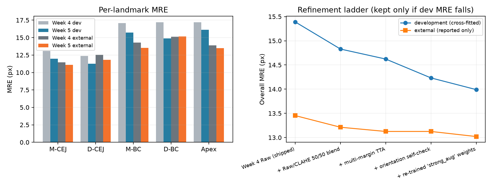

# Refined model vs Week 4

**Verdict.** On the held-out external test, the Week 5 system's MRE is not significantly different from
Week 4 (Δ -0.38 [-0.79, +0.01] px). On cross-fitted development OOF it is
significantly better (Δ -1.20 [-1.62, -0.84] ✓ px). Excluding fold 1, which was used to
screen configurations, development Δ is -1.22 [-1.64, -0.84] ✓ px. ✓/✗ mark 95% intervals that
exclude zero. Intervals come from a paired bootstrap that resamples whole radiographs, so correlated teeth
in one image are not counted as independent evidence.

## Protocol

- The split is exactly `week4/data/denpar_split_5fold.json`: radiograph-level, the same as Week 4.
- Configurations were screened on development fold 1 only: trained on its training radiographs and scored
  on its held-out radiographs. The external test was not used.
- The winning configuration was re-trained on all five folds (Raw and CLAHE). Development numbers are
  out-of-fold.
- Every post-processing parameter (blend, σ scale, orientation threshold, review policy) for held-out fold k
  was fitted on the other four folds. The external test was scored once, with parameters fitted on all
  development rows.

## Step 1: configuration screen (development fold 1, 275 teeth)

| Configuration | MRE px | Δ vs saved Week 4 [95% CI] | SDR@10 | ICC | κ | Stage acc. |
|---|---:|---:|---:|---:|---:|---:|
| `week4 (saved Week 4 checkpoint)` | 13.78 | reference | 57.6% | 0.918 | 0.886 | 86.0% |
| `week4 + multi-margin TTA` | 13.47 | -0.32 [-0.54, -0.11] ✓ | 58.3% | 0.931 | 0.891 | 86.7% |
| `week4 (re-trained, seed noise)` | 13.35 | -0.46 [-1.00, +0.07] | 58.0% | 0.946 | 0.889 | 86.4% |
| `lr_1e-3` | 13.89 | +0.11 [-0.47, +0.59] | 57.2% | 0.919 | 0.881 | 85.6% |
| `lr_2.5e-4` | 14.97 | +1.19 [+0.48, +1.93] ✗ | 54.3% | 0.901 | 0.878 | 86.3% |
| `strong_aug` | 13.30 | -0.48 [-1.33, +0.28] | 55.9% | 0.944 | 0.877 | 84.0% |
| `coord_0.1` | 13.66 | -0.15 [-0.77, +0.47] | 56.2% | 0.939 | 0.873 | 84.5% |
| `sigma_2` | 14.66 | +0.87 [+0.21, +1.57] ✗ | 56.4% | 0.894 | 0.865 | 83.0% |

`week4 (re-trained, seed noise)` repeats the Week 4 recipe with the same seed. GPU non-determinism alone
moves its MRE, so any difference smaller than that is not evidence. Selection rule, fixed in advance:
lowest fold-1 MRE, and only if it beats Week 4 by more than 0.1 px. Selected: **`strong_aug`**;
multi-margin TTA selected.

## Step 2: refinement ladder (each step kept only if cross-fitted development MRE falls)

| System | Dev MRE px | Dev stage acc. | External MRE px | External stage acc. | Decision |
|---|---:|---:|---:|---:|---:|
| Week 4 Raw (shipped) | 15.39 | 83.1% | 13.45 | 86.5% | kept |
| + Raw/CLAHE 50/50 blend | 14.83 | 83.7% | 13.21 | 86.8% | kept |
| + multi-margin TTA | 14.62 | 83.8% | 13.13 | 86.8% | kept |
| + orientation self-check | 14.23 | 84.7% | 13.13 | 86.8% | kept |
| + re-trained 'strong_aug' weights | 13.99 | 85.3% | 13.02 | 86.2% | kept |

The external columns are reported for transparency only. No decision used them.

## Step 3: final comparison

### External test (held out)

| Landmark | MRE px (Week 4 → Week 5) | SDR@2 / @5 / @10 | Along-axis MAE px | Perpendicular MAE px |
|---|---:|---:|---:|---:|
| Mesial CEJ | 11.44 → **11.11** | 4.9% / 26.0% / 56.0% → 6.7% / 28.4% / 58.4% | 10.20 → 9.82 | 3.42 → 3.54 |
| Distal CEJ | 12.52 → **11.79** | 4.3% / 24.5% / 59.6% → 4.9% / 28.7% / 60.9% | 10.90 → 10.07 | 4.15 → 4.23 |
| Mesial bone crest | 14.29 → **13.53** | 6.4% / 30.3% / 60.2% → 7.3% / 30.0% / 60.6% | 12.65 → 11.64 | 4.36 → 4.37 |
| Distal bone crest | 15.13 → **15.18** | 6.1% / 31.2% / 63.0% → 5.5% / 25.4% / 62.4% | 12.60 → 12.64 | 5.49 → 5.49 |
| Apex | 13.88 → **13.48** | 2.8% / 20.8% / 56.3% → 3.7% / 22.0% / 55.0% | 9.26 → 9.34 | 8.39 → 7.87 |
| All landmarks | 13.45 → **13.02** | 4.9% / 26.5% / 59.0% → 5.6% / 26.9% / 59.4% | 11.12 → 10.70 | 5.16 → 5.10 |

| Metric (paired, teeth valid under both) | Week 4 | Week 5 | Δ [95% CI] |
|---|---:|---:|---:|
| MRE px | 13.33 | 12.95 | -0.38 [-0.79, +0.01] |
| SDR@2 px | 4.9% | 5.6% | +0.7 pp [-0.5, +1.9] |
| SDR@5 px | 26.6% | 27.0% | +0.3 pp [-1.3, +2.0] |
| SDR@10 px | 59.1% | 59.5% | +0.4 pp [-1.2, +1.9] |
| Along-axis MAE px | 11.01 | 10.64 | -0.36 [-0.82, +0.03] |
| ICC(2,1) PBL% | 0.939 | 0.948 | +0.009 [-0.009, +0.033] |
| Quadratic weighted κ | 0.886 | 0.892 | +0.007 [-0.013, +0.030] |
| Stage accuracy | 86.5% | 86.2% | -0.3 pp [-2.7, +1.9] |

Unpaired totals: valid measurements 325/327 → 327/327;
Stage III/IV called I/II 9/83 → 7/84;
Bland–Altman bias -1.77 → -1.31 pp, limits-of-agreement width 25.1 → 23.8 pp.

### Development (cross-fitted out-of-fold)

| Landmark | MRE px (Week 4 → Week 5) | SDR@2 / @5 / @10 | Along-axis MAE px | Perpendicular MAE px |
|---|---:|---:|---:|---:|
| Mesial CEJ | 13.09 → **11.97** | 5.1% / 22.6% / 53.7% → 4.2% / 25.2% / 57.2% | 11.84 → 10.74 | 3.79 → 3.51 |
| Distal CEJ | 12.37 → **11.24** | 4.8% / 23.5% / 55.5% → 5.6% / 26.8% / 62.3% | 10.75 → 9.85 | 4.28 → 3.94 |
| Mesial bone crest | 17.08 → **15.72** | 5.0% / 25.6% / 59.8% → 5.9% / 28.0% / 61.4% | 14.80 → 13.65 | 5.49 → 4.97 |
| Distal bone crest | 17.21 → **14.90** | 4.5% / 23.9% / 58.6% → 4.7% / 25.7% / 61.7% | 14.88 → 12.73 | 5.63 → 5.18 |
| Apex | 17.20 → **16.13** | 4.9% / 20.2% / 50.0% → 3.5% / 19.2% / 50.2% | 10.90 → 10.61 | 10.63 → 9.67 |
| All landmarks | 15.39 → **13.99** | 4.9% / 23.2% / 55.5% → 4.8% / 25.0% / 58.5% | 12.63 → 11.51 | 5.96 → 5.45 |

| Metric (paired, teeth valid under both) | Week 4 | Week 5 | Δ [95% CI] |
|---|---:|---:|---:|
| MRE px | 14.31 | 13.11 | -1.20 [-1.62, -0.84] ✓ |
| SDR@2 px | 4.9% | 4.8% | -0.1 pp [-0.7, +0.6] |
| SDR@5 px | 23.4% | 25.2% | +1.8 pp [+0.7, +2.9] ✓ |
| SDR@10 px | 56.0% | 59.0% | +3.0 pp [+1.9, +4.2] ✓ |
| Along-axis MAE px | 11.69 | 10.74 | -0.96 [-1.36, -0.57] ✓ |
| ICC(2,1) PBL% | 0.905 | 0.920 | +0.015 [-0.009, +0.036] |
| Quadratic weighted κ | 0.852 | 0.873 | +0.022 [+0.007, +0.038] ✓ |
| Stage accuracy | 83.2% | 85.5% | +2.3 pp [+0.9, +3.8] ✓ |

Unpaired totals: valid measurements 1304/1330 → 1323/1330;
Stage III/IV called I/II 39/309 → 34/313;
Bland–Altman bias -1.23 → -1.08 pp, limits-of-agreement width 31.9 → 29.8 pp.

## Final configuration

`calibration.json` records the checkpoints, TTA margins, blend weights, per-landmark σ scales, orientation
threshold and review policy that the App loads. Weights and training logs are in `week5/weights/`; the
checksums are in `week5/weights/MANIFEST.json`.
