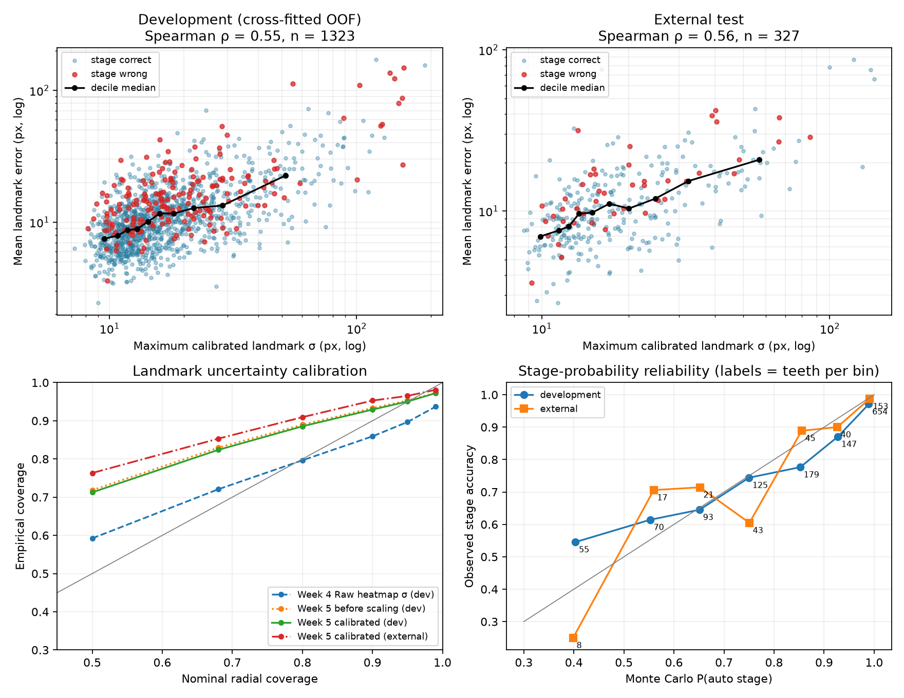
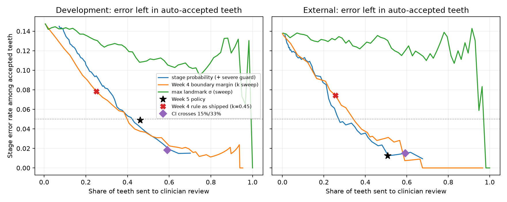

# Uncertainty calibration and revised review rule

## Do confidence estimates track accuracy?

Spearman correlation with error, and AUROC for detecting a wrong stage (0.5 = chance, 1 = perfect). Week 4
reference on development: ρ(max σ, error) = 0.58, AUROC
0.60.

| Confidence score | ρ error dev | ρ error ext | ρ abs PBL error dev | ρ abs PBL error ext | AUROC stage dev | AUROC stage ext |
|---|---:|---:|---:|---:|---:|---:|
| max landmark σ | 0.55 | 0.56 | 0.27 | 0.26 | 0.59 | 0.54 |
| mean landmark σ | 0.59 | 0.60 | 0.29 | 0.25 | 0.59 | 0.52 |
| 95% PBL CI width | 0.51 | 0.60 | 0.34 | 0.33 | 0.63 | 0.58 |
| 1 − P(auto stage) | 0.09 | 0.06 | 0.07 | 0.05 | 0.80 | 0.83 |

Landmark σ tracks *geometric* error well; it is strongest for gross failures (top-right of the scatter).
For predicting a *wrong stage*, `1 − P(auto stage)` is the best score, because a large but harmless
landmark error far from a stage boundary does not change the stage. This is why the review rule is built
on stage probability rather than on raw σ.

## Is the stated uncertainty honest?

| Landmark | Week 4 σ (dev) | Week 5 before scaling (dev) | Week 5 calibrated (dev, cross-fitted) | Week 5 calibrated (external) |
|---|---:|---:|---:|---:|
| Mesial CEJ | 88.5% | 96.0% | 94.9% | 96.0% |
| Distal CEJ | 90.7% | 95.7% | 95.0% | 96.3% |
| Mesial bone crest | 89.3% | 94.4% | 95.2% | 98.5% |
| Distal bone crest | 90.1% | 95.0% | 95.3% | 94.2% |
| Apex | 89.8% | 95.3% | 94.8% | 97.6% |
| All landmarks | 89.7% | 95.3% | 95.0% | 96.5% |

The table shows the share of true landmarks inside the nominal 95% radius. Week 4's heatmap σ was
over-confident. Week 5 adds Raw/CLAHE and test-time disagreement, then rescales each landmark on
development data only.

Landmark errors are heavy-tailed rather than Gaussian. Their radii therefore over-cover at lower
nominal levels and hit 95% only at the 95% level, which is the level the review rule and the interval use.

**Reassessed 95% PBL interval.** The interval comes from 1,000 Monte Carlo draws of all five landmarks
through the Week 3 calculator.

|  | Development | External |
|---|---:|---:|
| Week 4 Monte Carlo interval (heatmap σ) | 80.0% | 87.4% |
| Week 5 Monte Carlo interval (calibrated σ) | 86.1% | 89.9% |
| Week 5 reported interval (× 1.54 split-conformal stretch) | **95.2%** | **97.9%** |
| Median reported width (pp) | 17.9 | 18.6 |

Per-landmark calibration is not enough on its own. The few gross failures, and errors shared between
landmarks, push some true PBL values outside the Monte Carlo interval. Inflating σ until that interval
covered 95% would have made the stage probabilities under-confident. Instead, the reported interval is
stretched about the point estimate by a split-conformal factor fitted on development data (cross-fitted
fold factors 1.54, 1.54, 1.54, 1.54, 1.54). The stage probabilities keep the unstretched draws,
because they are already well calibrated.
- **Stage-probability calibration**: expected calibration error 0.036 dev /
  0.044 external; multi-class Brier
  0.222 / 0.196.

## High-confidence, large-error cases

Definition: max calibrated sigma <= 15.2px (development median) and mean error >= 22.5px (development 90th percentile).

- Development: 11 teeth, 3 with a wrong stage, **3 wrong and not flagged**;
  1 tilted, 2 multi-rooted.
- External: 2 teeth, 1 with a wrong stage, **0 wrong and not flagged**.

These are the confidently wrong cases that no uncertainty rule can catch. They remain the main reason
every automatic result is still shown to a clinician.

## Revised review rule

Recommend clinician review when **any** of the following holds:

1. the Monte Carlo probability of the automatic stage is below **94%**;
2. the automatic stage is I or II and P(Stage III/IV) ≥ **none**: a possible missed severe case;
3. the orientation self-check reversed the apex direction; or
4. no valid automatic measurement or interval could be produced.

The thresholds are the lowest review burden on development data that keeps accepted-tooth stage accuracy
≥ 95% and accepted Stage III/IV misses ≤
0% of all III/IV teeth (targets met:
True). Refitting on each set of four folds gave thresholds
94%, 87%, 94%, 84%, 94% with guards
none, 5%, none, 2%, none, so the rule is stable.
Development numbers below use these held-out-fold rules.

| Rule | Dev review | Dev accepted acc. | Dev accepted III/IV misses | Ext review | Ext accepted acc. | Ext accepted III/IV misses | Ext stage-error recall |
|---|---:|---:|---:|---:|---:|---:|---:|
| Week 5 policy | 46.2% | 95.1% | 2/315 | 50.8% | 98.8% | 1/84 | 95.6% |
| Week 5 first-run target (τ=0.87, guard 0.05) | 41.1% | 95.0% | 2/315 | 37.3% | 96.1% | 1/84 | 82.2% |
| Week 5 at Week 4's review burden (τ=0.710) | 22.6% | 90.2% | 14/315 | 15.9% | 90.5% | 3/84 | 42.2% |
| Week 4 rule as shipped (k=0.45) | 25.1% | 92.2% | 12/315 | 25.7% | 92.6% | 2/84 | 60.0% |
| Week 4 rule re-tuned to 95% (k=0.75) | 40.8% | 95.4% | 4/315 | 42.2% | 96.8% | 1/84 | 86.7% |
| CI crosses 15%/33% | 59.2% | 98.2% | 1/315 | 59.3% | 98.5% | 1/84 | 95.6% |
| Week 4 system as shipped (Week 4 Raw + k=0.45) | 22.6% | 90.4% | 13/315 | 25.1% | 94.3% | 1/84 | 69.6% |

On the external test, the Week 5 rule refers 50.8% of teeth, keeps 98.8%
stage accuracy among auto-accepted teeth, and leaves 1 Stage III/IV miss(es) unflagged. The
Week 4 system as shipped referred 25.1%, with 94.3% accepted accuracy
and 1 unflagged severe miss(es).

**Trade-off, stated plainly.** The Week 5 rule is *safer*, not *cheaper*. It meets the clinical targets
by referring roughly twice as many teeth. At Week 4's review burden, the Week 5 stage-probability rule
gives 90.2% accepted accuracy on development, against
90.4% for Week 4. That is no better at equal burden. The real gains in uncertainty are that
the intervals and stage probabilities now mean what they say (coverage and calibration above), and that
a wrong stage is far easier to detect (AUROC above). The risk–coverage curves compare the rules at every
possible review burden, not just at one operating point.
