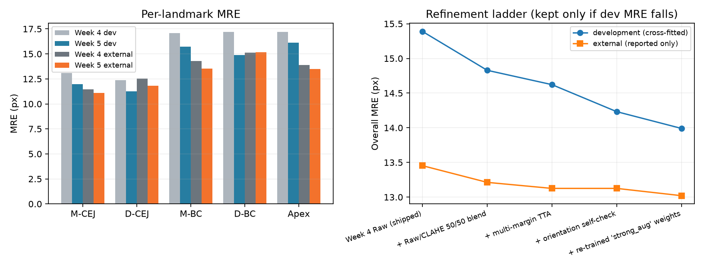
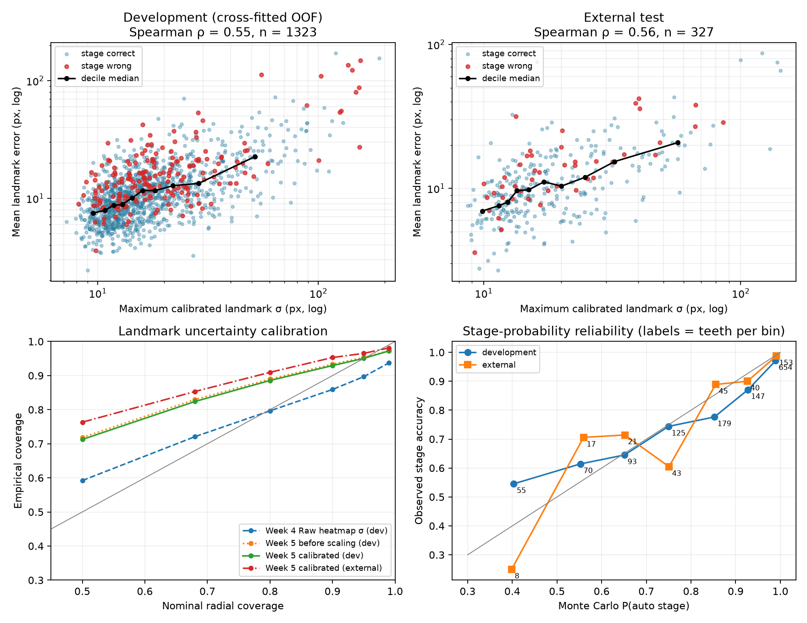
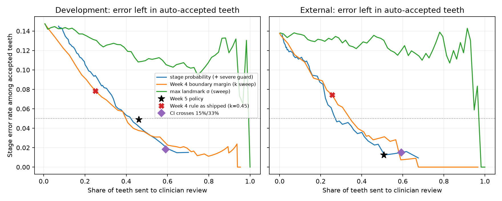
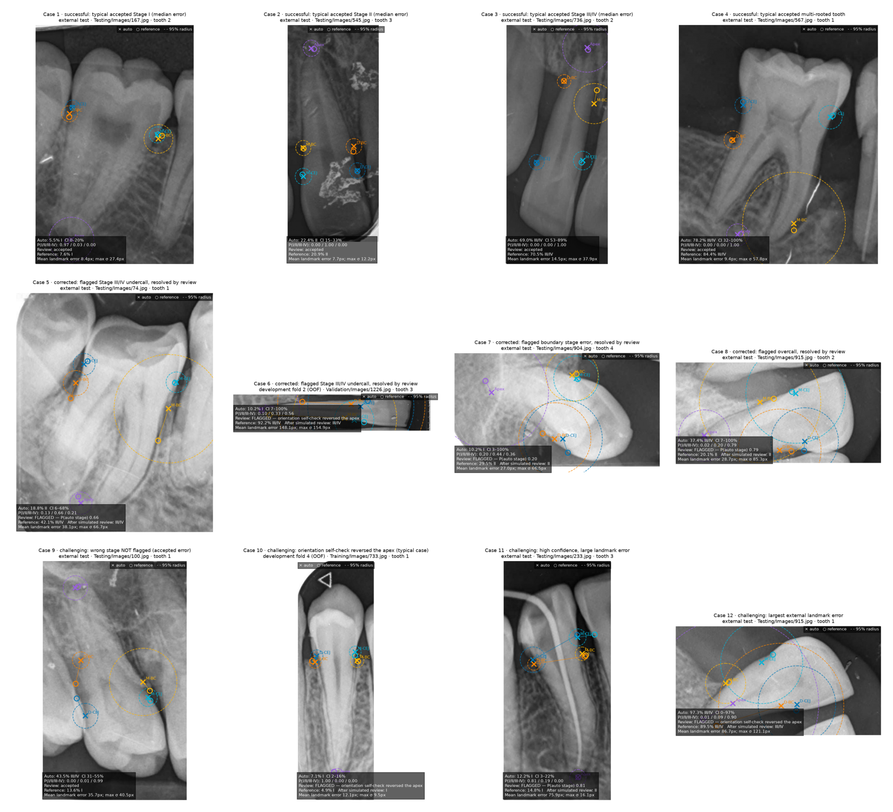

# Week 5: Model Refinement and Clinical Review

## Introduction

For Week 5, I continued the automated landmark detector from Week 4. I focused on the cases where the
model was still unreliable. The main problems were incorrect tooth orientation, bone-crest and CEJ errors
along the tooth axis, and confidence estimates that were too narrow.

I used the same radiograph-level split as Week 4. Model choices were made with development data only. The
external test set contains 327 teeth and was used after the settings were fixed.

## What I changed

I screened different learning rates, augmentation settings, heatmap targets and coordinate losses on
development fold 1. Stronger augmentation had the lowest error, so I trained that configuration on all five
folds. I also tested a Raw and CLAHE image blend, multi-margin test-time augmentation and an orientation
self-check. I kept a step only when development error decreased.

| Model step | Development MRE (px) | Development stage accuracy |
|---|---:|---:|
| Week 4 Raw (shipped) | 15.39 | 83.1% |
| + Raw/CLAHE 50/50 blend | 14.83 | 83.7% |
| + multi-margin TTA | 14.62 | 83.8% |
| + orientation self-check | 14.23 | 84.7% |
| + re-trained 'strong_aug' weights | 13.99 | 85.3% |



The final pipeline uses stronger augmentation, a fixed 50/50 Raw and CLAHE blend, three crop margins at
test time and the orientation self-check. The orientation check changed 84 development predictions. Of
those, 70 had incorrect orientation metadata. The remaining 14 changes were false switches and were all
sent for review.

## Results

The table below uses paired teeth that both Week 4 and Week 5 measured successfully. Confidence intervals
come from a bootstrap that resamples complete radiographs instead of treating teeth from the same image as
independent.

| Metric | Week 4 | Week 5 | Change [95% CI] |
|---|---:|---:|---:|
| Development MRE | 14.31 | 13.11 | -1.20 [-1.62, -0.84] ✓ |
| Development SDR@10 | 56.0% | 59.0% | +3.0 pp [+1.9, +4.2] ✓ |
| Development stage accuracy | 83.2% | 85.5% | +2.3 pp [+0.9, +3.8] ✓ |
| External MRE | 13.33 | 12.95 | -0.38 [-0.79, +0.01] |
| External stage accuracy | 86.5% | 86.2% | -0.3 pp [-2.7, +1.9] |

Development MRE improved by 1.20 px, and its confidence interval stayed below
zero. SDR@10 and stage accuracy also improved on development data. On the external test, MRE decreased by
0.38 px, but the confidence interval included zero. External stage accuracy was
almost unchanged. I therefore found a clear development improvement, but not a confirmed external
improvement.

## Uncertainty and review rule

I recalibrated the landmark uncertainty and used 1,000 Monte Carlo samples to estimate PBL intervals and
stage probabilities. The reported 95% PBL interval covered the reference in
95.2% of development teeth and
97.9% of external teeth.



The review rule flags a tooth when the automatic stage probability is below 94%, the orientation check
changes the direction, or the measurement fails its geometry checks. On the external test it sent
50.8% of teeth for review. Accuracy among the accepted teeth was
98.8%. One of 84 Stage III/IV teeth was still missed
and accepted automatically. The rule improved safety, but it also increased the amount of manual review.



## Clinician correction and examples

The app now keeps the automatic and corrected results as separate records. A reviewer can move any of the
five landmarks and immediately recalculate PBL and stage. The export includes both results, the review
reason, uncertainty, timing and landmark movement.

I prepared 12 examples: 4 successful predictions,
4 corrected predictions and 4 challenging cases. In the simulated
external review, replacing all five landmarks resolved about
70% of flagged stage errors. It also changed about
21% of correctly staged flagged teeth to the wrong stage.
This simulation shows why the next study needs real clinicians.



## Limitations

- The external MRE change was small and not statistically significant.
- The review rule sent about half of the external teeth for manual review.
- One severe external miss was not flagged.
- The correction study used simulated reviewer noise from my Week 3 readings, not real clinicians.
- DenPAR is one research dataset, so these results do not establish performance on other image sources or populations.
- This project is a research prototype and is not a diagnostic device.

## Reproduction

The figures in this report are generated by Python from the saved per-tooth predictions:

```bash
python -m week5.reproduce
```

This command rebuilds the metrics, Markdown reports, plots and clinical examples, runs the Week 5 tests and
checks the saved outputs. Re-running inference from the released weights is available with
`python -m week5.reproduce --from-weights`.

## Conclusion

Week 5 reduced landmark error on development data and made the confidence intervals more honest. The
external results moved in the same direction, but they did not show a statistically significant gain. The
review workflow can identify most stage errors and preserve the original prediction, but it still requires
substantial clinician review. My next step would be a reader study with real clinicians on new images.
